# Jarvis, a French voice assistant for Windows 11

**Français : [README.md](README.md)** · **Current version: 1.32**

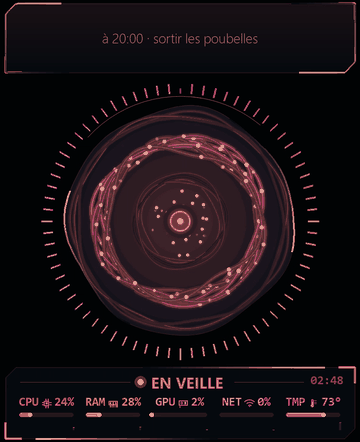

**▶ Everything it can do, on video (20 min, in French): [I built my own JARVIS: everything it can do](https://www.youtube.com/watch?v=xOM06Lr_elk)** · the first demo (6 min): [watch on YouTube](https://www.youtube.com/watch?v=3Xd91q7618U)

**Jarvis is a voice assistant for Windows 11 that speaks and understands French.** Say "Jarvis", then your request: it answers aloud and acts on your PC. It opens apps, manages windows, plays music, sets reminders, reads or translates copied text, and describes what is on screen. Simple requests are handled on the PC in about a second; everything else is sent to Claude.

An animated reactor sits in a corner of the screen and shows what Jarvis is doing: listening, thinking, answering.

> **Language note.** The voice commands, the spoken answers and the on-screen labels are in French only. This page is in English so the project is easier to find and understand, but you need to speak French to Jarvis.

## The settings window

Everything can be set without editing a file: right-click the reactor then « Réglages… », or say « **Jarvis, ouvre les réglages** ». Every change applies live, with a preview of the reactor.

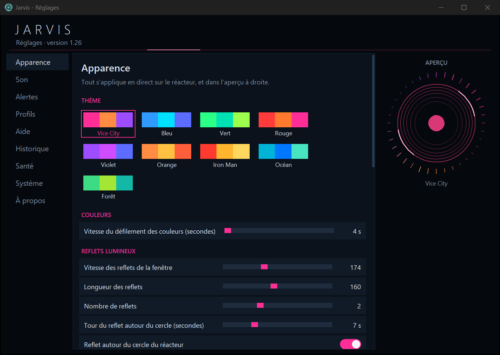
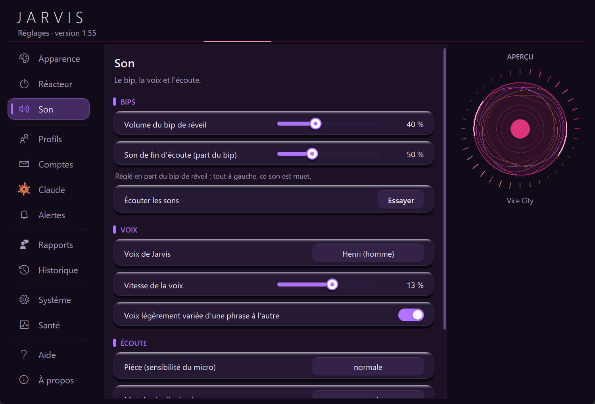
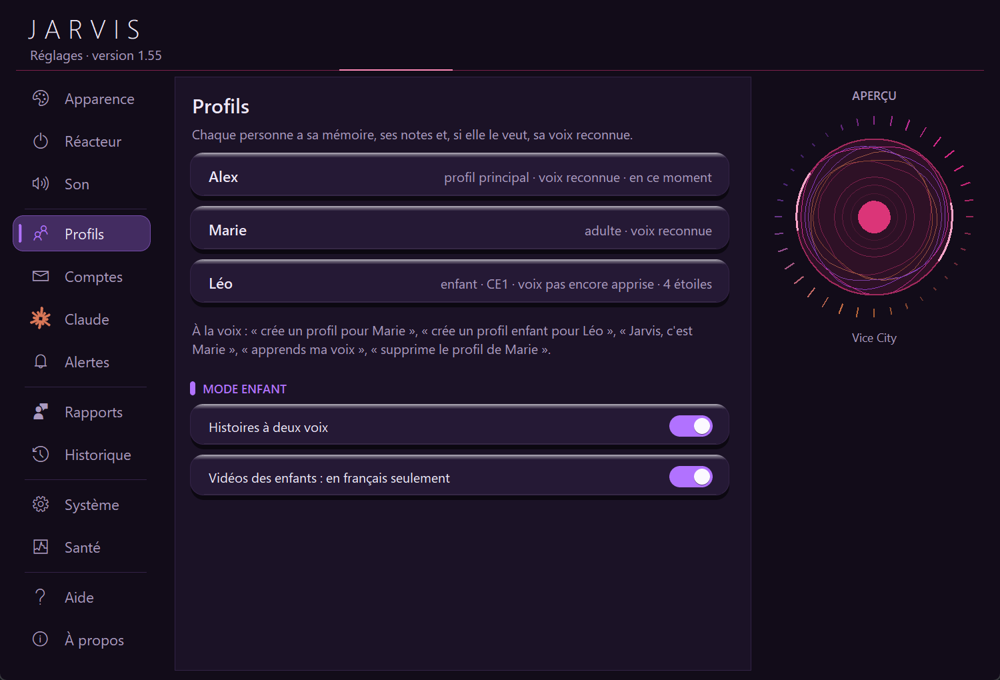
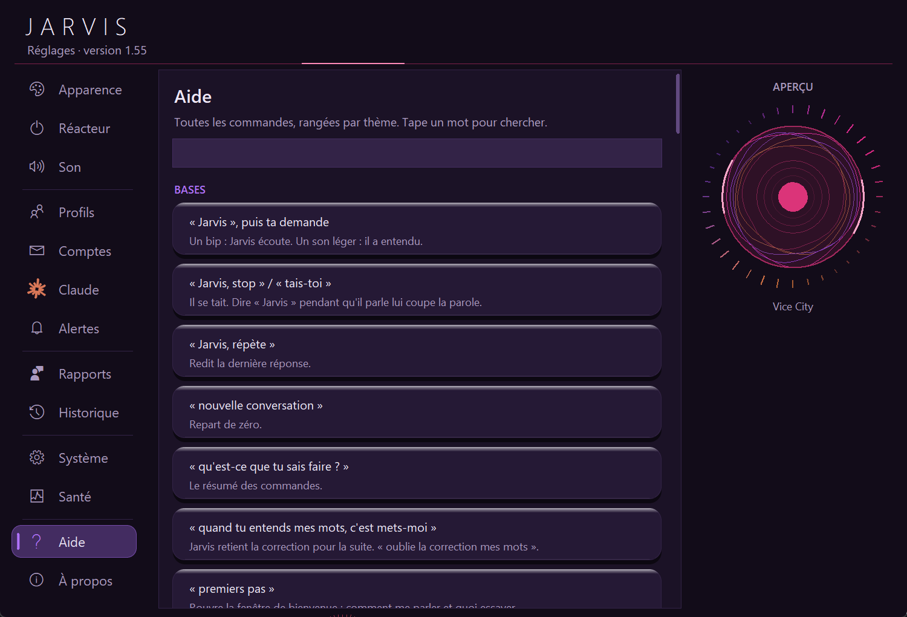

- **Apparence** (appearance): ready-made themes (Vice City, Iron Man, Ocean, Forest, Aurora, Galaxy...), a preview of a theme just by hovering it, reflections, mouse tracking, dancing to music, compact mode, gauges, position and size.
- **Son** (sound): beeps, male or female voice, speed, microphone and wake-word sensitivity, French-only videos for kids.
- **Alertes, Profils, Historique**: weather alerts, household members, the latest requests and answers.
- **Aide** (help): every command by theme, with search.
- **Santé** (health): a one-click check of the microphone, speaker, speech recognition, Claude, connection and disk.
- **Système**: start with Windows, backup and restore, and « Par défaut » to reset the settings (profiles, memories and voices are kept).
- **À propos** (about): the version, updates, and the « Désinstaller Jarvis… » (uninstall) button.

## New in 1.32

- **Important updates wait for a quiet moment**: Jarvis installs them after one minute idle with no request (five minutes after a request from a tablet, so a workshop or a story is not interrupted).

## New in 1.31: important updates installed right away

- **Important updates**: when a version fixes an important problem, Jarvis installs it by itself as soon as it is idle (it warns you first, then restarts). Other versions are still announced and installed only after your "yes".
- Jarvis checks for a new version every 15 minutes, not only at start-up.
- Reports also hide the département and nearby towns.
- New reactor animation at the top of this page.

## New in 1.30: help improve Jarvis

- **Reports, only with your consent**: on first launch, Jarvis asks whether it may send a daily technical report (misunderstood phrases, errors, response times, features used…) or a full report (with conversations). First names, city, emails and numbers are removed before sending; your voice is never sent. Everything can be changed or erased in the settings, "Rapports" section. An anonymous counter (a random number) counts users; it can be switched off too. Details: [docs/confidentialite.md](docs/confidentialite.md) (French).
- **"Report a problem" and "Suggest an improvement"**: in the right-click menu and in the settings.
- **A three-question survey**, once, after one week.
- **The microphone muted for Jarvis only**: the Windows microphone stays on, and "**Jarvis, rallume ton micro**" turns it back on by voice.
- **The reactor stays on the desktop**, behind your windows (it still listens and answers); "always on top" can be restored in the settings. In full screen (video, game), it goes behind.
- **Example requests** scroll in the chat window, on the PC and on the tablet.
- Jarvis no longer answers "can you repeat?" when a video says "Jarvis"; in the dictation workshop, the word is no longer shown on screen.

## New in 1.29: a new look, and the tablet for children

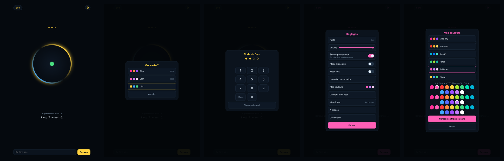

**On the tablet** (app 1.15):
- **A redesigned reactor**, close to the PC one, that follows Jarvis's voice while he speaks; the app lightens itself automatically on a slower tablet.
- **Say "Jarvis"**, a beep shows he is listening, then speak (tapping the circle still works). Voice wake-up uses the PC's wake-word detector, if there is one.
- **Workshops for children**: sums, "how do you spell…", dictation, guess the animal, telling the time. One star per right answer, a reward every 10, and questions that adapt: harder after a good streak, easier after two misses.
- **A child's voice** for Jarvis on children's profiles.
- **Timers, reminders and calendar events** shown with a countdown.
- **Messages between profiles** ("tell Léa I'll be late") also delivered on the tablets, and "répète" to hear the last answer again.
- **Settings sorted into sections**, new themes (Paillettes, Récré, Aurora, Galaxy) or three colours of your choice, and a "What can I ask?" page with examples.
- **A home-screen widget** in the profile's colours, and the battery: "Pense à recharger ta tablette" at 15 %.
- **Faster answers**: sentences already spoken are kept, and the voice starts before the end of a long answer.

**On the PC**:

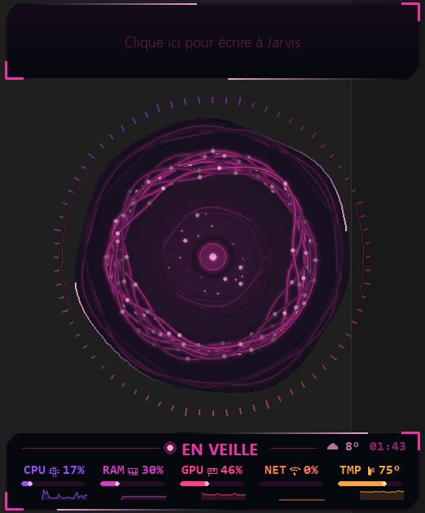
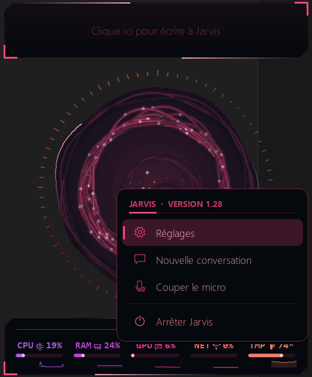

- **A modernised panel**: status dot, weather and time, slim gauges with a two-minute history curve, and the tablets' status (battery).
- **A new right-click menu** in the reactor's colours, with **"Couper le micro"** (mute the microphone, also by voice: "Jarvis, coupe le micro"); a badge on the reactor shows it.
- **The reactor lights up layer by layer** at start-up; a ringing reminder shows in a pill; after a restart, Jarvis simply writes "Je redémarre." without saying it.
- **Modernised settings**: icons, cards, gradient themes, a reactor preview with its filaments. And a **new icon**.

## New in 1.28: Jarvis on the tablet

- **An Android app** (Android 8 to 16): the QR-code page offers it; it installs without the Play Store and updates from the tablet (settings wheel, « Mise à jour »).
- **Always listening**: say « Jarvis, quelle heure est-il ? » without touching the tablet. Your sentence is shown, then replaced by the answer, as on the PC. It can be turned off in the settings wheel; while it is on, the screen stays on.
- **One profile per person**, with its own colours (six palettes, or any three colours) and its own conversation. A child gets in without a code; an adult types a 4-digit code. « Jarvis, c'est Léo » switches profile, and the tablet reopens on the last profile used.
- **Without Claude**: « ouvre YouTube Kids » opens the tablet's app; recipes, web, image and YouTube searches open the browser; time, weather and calculations answer at once.
- **Your data stays on your PC.** Only the text of questions and answers goes through Claude and the online voice. The last 1,000 requests of each profile are kept on the PC.
- **Above the reactor**, on the PC, a chat window where you can also type your request.

## New in 1.26 and 1.27: full uninstall, several TVs, PS5

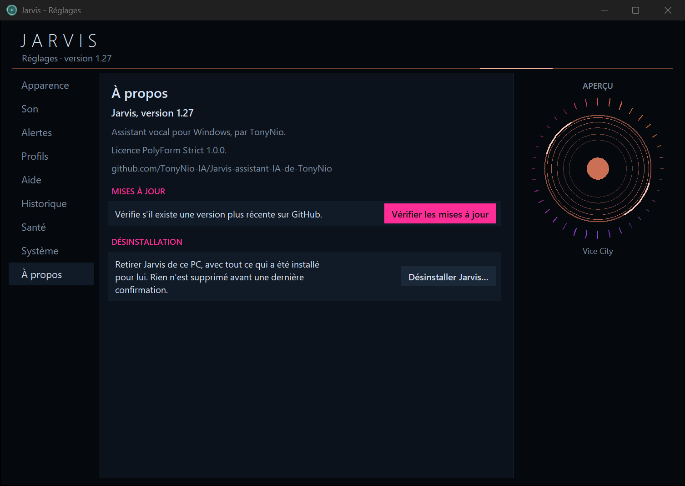
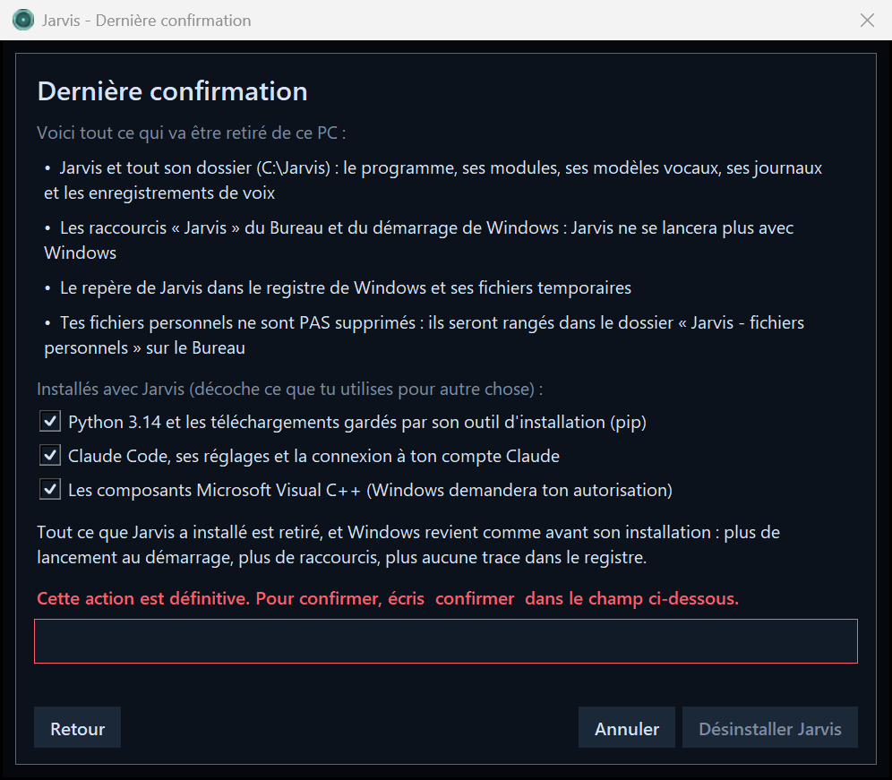

- **Uninstall Jarvis** from its settings (« À propos » tab): you choose whether to keep your personal files, you see the list of everything that will be removed, and nothing is deleted before you type « confirmer ». See [Uninstall](#uninstall).
- **Installer 1.1**: it explains what the Claude subscription adds, records what it installs itself, restores the personal files kept during an uninstall, and ends with a « À retenir » (things to remember) box.
- **Several TVs**: « mets France 2 sur la télé de la chambre ». See [The home](#the-home).
- **PlayStation 5**: « est-ce que la PS5 est allumée ? », « allume la PS5 », « mets la PS5 en veille ». Since 1.27, everything it needs is installed automatically with Jarvis; you just link the console once (« Jarvis, relie la PS5 »).
- **Faster wake-up** when you say « Jarvis » alone, with the optional wake-word detector.
- **Understanding**: « c'est quoi mon prochain rendez-vous ? » is answered at once; several misheard sentences are better understood; a sentence about the TV no longer starts music on the PC.

## New in 1.25: the home, the calendar and mails

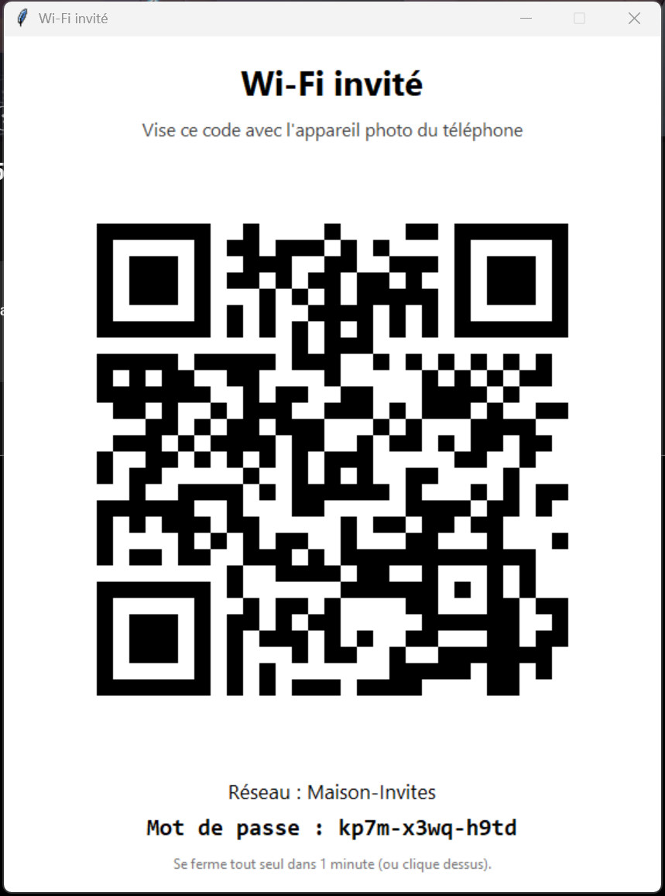

- **TV and Apple TV**: « allume la télé », « mets France 2 », « monte le son de la télé », « lance Netflix sur l'Apple TV », « qu'est-ce qui passe sur l'Apple TV ? ». See [The home](#the-home).
- **Freebox** (French internet box): missed calls, internet status, connected devices, and a **guest Wi-Fi** created by voice, with a **QR code** on screen for guests to scan (the password is never spoken aloud).
- **Printer**: « il reste combien d'encre ? » (ink levels).
- **iCloud calendar**: « c'est quand le dentiste ? », « qu'est-ce que j'ai cette semaine ? », and a reminder the evening before. See [iCloud calendar](#icloud-calendar).
- **Sending mails**: « envoie un mail à Marie pour lui dire que je serai en retard ». Jarvis reads it out and shows it, and sends it only after your « oui ».
- **Everyday info**: cheapest fuel nearby, school holidays and bank holidays, "on this day", bin collection days with a reminder the evening before.
- **Repeating reminders** (« tous les lundis à 8 h »), a **speaking style** per profile (shorter, more humour, formal "vous"), and **background tasks** handed to Claude (« prends ton temps et compare les forfaits mobiles »).

## What you need

- **Windows 11** (64-bit) and a **microphone**.
- An Internet connection during setup, and about **3 GB** of free disk space.
- Optional: a **Claude subscription** (Pro or higher), to ask it anything. Without it, Jarvis answers the instant commands: time, weather, timers, windows, music.
- Nothing else to pay for: speech recognition and the voice use free tools.

## Installation

1. **Download the installer: [Installer-Jarvis.exe](https://github.com/TonyNio-IA/Jarvis-assistant-IA-de-TonyNio/releases/latest/download/Installer-Jarvis.exe)** (about 200 KB).
2. **Double-click it.** Windows will probably show a blue screen, "Windows protected your PC": this is normal for a small free program that is not signed by a paid publisher. Click **More info**, then **Run anyway**.
3. **Answer the two questions** (in French): your first name, and whether you want to use your Claude subscription (the installer explains what it adds; you can link it later). Then setup runs by itself (about ten minutes, depending on your connection and PC). It installs:
   - Python 3.14 (from python.org), in your user folder;
   - the Microsoft Visual C++ components: Windows asks for your permission, answer **Yes**;
   - Jarvis, its modules (PlayStation 5 included), its speech model and the one that recognises who is speaking, in `C:\Jarvis`;
   - Claude Code (from claude.ai), if you chose it;
   - a "Jarvis" shortcut on the desktop and at Windows startup.
4. **If you chose Claude**, your browser opens so you can sign in to your Claude account. On a new PC, it may first show its own welcome screen: skip it. Sign in, accept the authorization, then go back to the installer window.
5. **At the end, Jarvis starts.** The first launch takes a minute or two: it downloads its second speech model (Whisper). The very first check can also be slow on a new PC, while Windows examines the new files.

To get your local weather, say once: "**Jarvis, ma ville est** …" followed by the name of your town.

**Update, repair, add Claude or uninstall:** run the same file again. A copy is also kept in `C:\Jarvis` (Windows key + R, type `C:\Jarvis`, then Enter). A menu lets you update, uninstall, or add Claude if it is missing. Updating keeps your settings, its memory and your reminders.

**Uninstall:** in Jarvis's settings, « À propos » tab, click « Désinstaller Jarvis… » (or run the installer again and choose « Désinstaller »). A first window asks what to do with your personal files (settings, profiles and voices, memory, reminders, notes, lists): keep them in a « Jarvis - fichiers personnels » folder on the desktop, or delete them, with a compressed copy if you wish. A last window lists everything that will be removed: the Jarvis folder, its shortcuts (desktop and Windows startup), its registry marker, its temporary files, plus Python, Claude Code and the Microsoft Visual C++ components. These last three are ticked by default: **untick the ones you use for something else**. Nothing is deleted until you type « confirmer ». If you install Jarvis again later, the installer offers to restore the kept files.

**If your antivirus rejects the .exe file:** download [Installer-Jarvis.bat](https://github.com/TonyNio-IA/Jarvis-assistant-IA-de-TonyNio/releases/latest/download/Installer-Jarvis.bat) instead. It runs exactly the same setup, without the reactor icon. The code of both is readable in the project's `installateur` folder.

Manual installation (for the curious)

1. Download the project (green **Code** button, then **Download ZIP**) and unzip it, for example into `C:\Jarvis`.
2. Install Python 3.14, then the modules from that folder: `python -m pip install -r requirements.txt`
3. Download the French speech model **vosk-model-small-fr-0.22** from https://alphacephei.com/vosk/models and unzip it into the same folder.
4. Copy `config.exemple.json`, rename the copy to `config.json`, and put your first name in it.
5. Start Jarvis: `pythonw jarvis_gardien.py`. To start it with Windows, put a shortcut to this command in `shell:startup`.

## Personal settings

These files stay on your PC, in the Jarvis folder. They are not part of the published project.

| File | Content |
|---|---|
| `config.json` | Your first name, the topics of your daily briefing, a website to check, proper nouns you say often, and optional fixed night mode hours. Template: `config.exemple.json`. |
| `ville.txt` | Your town for the weather. The easiest way: say "Jarvis, ma ville est …" and it creates this file. Format: `Name;latitude;longitude` (example: `Paris;48.8566;2.3522`). Without this file, Jarvis gives the weather for Paris. |

Jarvis also creates its own files as you use it (memory, reminders, notes, lists, voice settings, app list, log). They never leave your PC either.

## What it can do

The commands below are the French phrases Jarvis understands, with their meaning.

**Talking to it**
- It wakes up when a sentence starts with "Jarvis" (a short beep tells you to speak), including while a video or music is playing; it then turns the PC sound down while it listens.
- You can chain another request within 3 seconds without saying "Jarvis" again.
- It remembers the conversation for 10 minutes. « Jarvis, nouvelle conversation » starts over.
- « Stop » or « Tais-toi » while it speaks: it stops. « Jarvis, répète »: it repeats its last answer.

**Instant commands, handled on the PC without Claude**
- Time, date and weather: « quelle heure est-il », « quel temps fait-il demain ».
- Volume and media: « monte le son », « mets en pause », « musique suivante ».
- Timers and reminders: « mets un minuteur de 10 minutes », « rappelle-moi à 18 h d'appeler le garage ». They survive a restart and show on the reactor.
- Apps and windows: « ouvre Chrome », « ferme la fenêtre », « mets Chrome à gauche », « mets la fenêtre en plein écran », « affiche le bureau ». The name of an open app is recognized even when misheard.
- Music: « mets Get Lucky de Daft Punk » plays it on YouTube.
- Files and screen: « cherche le fichier facture », « fais une capture d'écran ».
- Dictation: « dicte : je serai là dans dix minutes » types the sentence into the active window.
- Notes and memory: « note que... », « retiens que... », « qu'est-ce que tu as retenu ? », « oublie que... ».
- Power, always after confirmation: « éteins l'ordinateur », « redémarre l'ordinateur », « mets l'ordinateur en veille ».
- Routines: « Jarvis, bonjour » (date, time, weather, today's reminders, PC status) and « Jarvis, bonne nuit » (closes apps and puts the PC to sleep).
- PC status: « état du PC » gives processor, memory, the heaviest program and disk space.

**With Claude**
- Any question, and any action on the PC that is not an instant command.
- Screen: « qu'est-ce qu'il y a à l'écran ? », « explique-moi cette erreur ». Jarvis captures the active window and Claude looks at it.
- Copied text: « résume le texte copié », « traduis le texte sélectionné en anglais », « corrige le texte copié ». The result goes back to the clipboard, ready to paste.
- Daily briefing: « fais-moi le point du jour » gives the weather, the news, then your own topics.

**New in 1.20 (also instant, without Claude)**
- Maths and conversions: « combien font 15 % de 80 », « 3 miles en kilomètres », « 50 dollars en euros » (European Central Bank rates).
- Stopwatch: « lance un chrono », « arrête le chrono ». Lists: « ajoute du pain à la liste », « lis-moi la liste ».
- Keyboard shortcuts in the active window: « copie », « colle », « annule ça », « sélectionne tout », « enregistre ».
- Videos: « avance de 30 secondes ». One app's volume: « baisse le son de Chrome ».
- Browser by voice: « cherche des recettes sur YouTube », « clique sur Connexion », « clique sur la deuxième vidéo », « clique sur le premier résultat », « fais défiler », « reviens en arrière », « lis-moi cette page », « résume cette page ».
- Windows: dark or light mode, Bluetooth on or off, screen brightness (on screens that allow it from Windows).
- Jarvis on a tablet or phone at home: « active la tablette » shows a QR code; scan it with the tablet, accept the security warning (the certificate is made by your Jarvis), then install the Android app the page offers (or use the page in the browser). During the 10 minutes after the QR code is shown, each adult chooses a 4-digit code on the tablet. Jarvis answers on the tablet in writing and aloud, opens the tablet's apps and runs searches, but performs no action on the PC or the house. « désactive la tablette » closes the access. Away from home, the tablet can reach Jarvis through your router's VPN (WireGuard on a recent Freebox, for example).
- Night mode, only when you ask for it (« active le mode nuit »): answers are written in the chat panel above the reactor, with no voice or beep (reminders still ring). It stays on, even after a restart, until « désactive le mode nuit ». Fixed hours are possible in `config.json`: `"mode_nuit": {"debut": 22, "fin": 7}`.
- Voice: a female voice (« prends une voix de femme »), faster or slower speech. « Qu'est-ce que tu sais faire ? » lists the commands.

**New in 1.24**

- The settings window above, plus a family calendar, messages between profiles, a family quiz (« avec Léo », « Marie ne joue pas »), a daily challenge with stars and two-voice stories.
- Better understanding: built-in fixes for common mishearings, and your own (« quand tu entends mes mots, c'est mets-moi »); one-word commands (« pause », « suivant »).
- Reliability: « Jarvis, fais un diagnostic », a report after a crash, app volumes always restored.
- Safety, after a full voice test: cancelling a timer no longer clears reminders, asking whether night or kids mode is on no longer turns it on, « verrouille l'ordinateur » asks for confirmation, and one person's voice can no longer be mixed into another's voiceprint.
- French-only videos for kids, cleaner page reading, and the morning song keeps the real title even when misheard.

**New in 1.23**
- Météo-France weather warnings (Vigilance) for your département, found from your city: yellow, orange or red, announced once, with the reactor animated in the warning colour and a symbol. No account or key needed: Jarvis reads the Vigilance map that Météo-France publishes as open data on data.gouv.fr.
- Time in another city (« quelle heure est-il à Tokyo ? »), last download, reopen Chrome tabs (« où j'en étais ? »), « ferme tout » with confirmation, step-by-step recipes (« étape suivante »), relatives' birthdays reminded the day before and on the day, anecdotes, YouTube video summary, read the selected text (« lis ça »).
- One profile per household member (« crée un profil pour Marie », then « Jarvis, c'est Marie »): separate memory and notes; reminders, shopping list and city stay shared.
- Named kitchen timers, homework help and bedtime story for kids' profiles, a summary of the day, a morning song per profile, and optional speaker recognition to switch profiles by voice.
- Family calendar, messages between profiles, family quiz, daily challenge with stars, two-voice stories, a three times bigger reactor in kids mode, and a settings window in Jarvis's colours (right-click the reactor, « Réglages… »).
- Cinema mode, guest mode (no mails, notes or memory), reactor colours of your choice, and a guided first run for new users (one question at a time).

**New in 1.22**
- Kids mode, mails on request and a more reliable daily briefing (see below).
- Say « Jarvis » while it speaks: it stops at once and listens to your new request.
- More natural, varied answers, a greeting for the day, a small chime after long tasks.
- Display: Vice City sunset colours when idle, a compact gauges-only strip after 35 s, gauge icons, a light glint running around the panels and the reactor, the reactor dances with music, looks towards the mouse, dims at night, and celebrates midnight and your birthday.

**New in 1.21: updates**
- At startup, Jarvis checks GitHub for a new version. If there is one, it tells you at your next request and asks whether to install it; nothing happens without your « oui ». Your settings, memory, reminders and lists are kept. By voice too: « Jarvis, cherche les mises à jour », « mets-toi à jour », « quelle est ta version ? ».
- Night mode now turns on only when you ask for it, no longer at fixed hours.

**Mails, only when you ask** (« est-ce que j'ai des nouveaux mails ? », « lis-moi mes mails », « lis-moi le premier mail »)
- Jarvis never deletes or moves a mail, mails stay unread, and their content is not sent to Claude.
- One-time setup in PowerShell: `cmdkey /generic:Jarvis-Mails /user:your.address@icloud.com /pass` (Windows then asks for the password, stored by Windows, never in a file). For iCloud, use an app-specific password from account.apple.com. Other providers: `"mails": {"serveur": "imap.gmail.com"}` in `config.json`.
- Sending (new in 1.25, same password): « envoie un mail à Marie pour lui dire que je serai en retard », « envoie-moi un mail pour me rappeler d'appeler le garage ». Jarvis reads the mail out and shows it with the address, then waits for your « oui »: nothing is sent without it. The recipient is looked up in your iCloud contacts that have an email address and among people you already wrote to; a copy is kept in your Sent folder. Refused in kids and guest modes.

**iCloud calendar** (new in 1.25)
- On the iPhone: Calendar app, « Calendars », the **i** next to the calendar, turn on « Public Calendar », then « Share Link ». Store the link once in Windows: `cmdkey /generic:Jarvis-Agenda /user:agenda /pass`, and paste the link when Windows asks for the password. It is never written to a file.
- Then: « c'est quand le dentiste ? », « c'est quand mon prochain rendez-vous ? », « qu'est-ce que j'ai cette semaine ? ». At 7 pm, Jarvis reminds you of the next day's appointments. A new appointment is seen within about a minute.

**The home** (new in 1.25; everything stays on your local network, each device is paired once)
- **Freebox**: say « connecte-toi à la Freebox » and confirm on the box's screen; then tick the "Jarvis" app's rights in Freebox OS (access management) for settings and calls. « Est-ce que j'ai eu des appels ? », « est-ce qu'Internet marche ? », « combien d'appareils sont connectés ? », « crée un Wi-Fi invité pour 2 heures » (a QR code opens on screen), « montre le QR code du Wi-Fi invité », « ferme le Wi-Fi invité ».
- **TV (Freebox Player POP or another Android TV)**: say « associe la télé » and type the code shown on the TV. Then « allume la télé », « mets France 2 », « mets la chaîne 27 », « monte le son de la télé de 5 », « mets la télé en pause », « lance Netflix sur la télé ».
- **Apple TV**: say « associe l'Apple TV » and type the two 4-digit codes. Then « allume l'Apple TV », « mets l'Apple TV en pause », « qu'est-ce qui passe sur l'Apple TV ? », « lance YouTube sur l'Apple TV » (any installed app).
- **Several TVs** (optional): describe them in the `tele/teles.json` file (an example is given at the top of `jarvis_tele.py`), then say « associe la télé de la chambre ». Then « allume la télé de la chambre », « mets France 2 sur la télé du salon ». Without a room, Jarvis talks to the default TV.
- **PlayStation 5**: « est-ce que la PS5 est allumée ? », « la PlayStation est en veille ? »: Jarvis says whether it is on, in rest mode or off, with nothing to set up. To turn it on or put it to rest mode by voice, link it once: say « **relie la PS5** », sign in to your PlayStation account in the window that opens, then type the code shown by the console (Settings, System, Remote Play, Link Device). Then « allume la PS5 » (it must be in rest mode) and « mets la PS5 en veille » (Jarvis asks for confirmation, since a game in progress stops). The link to your account stays in your user folder (`.pyremoteplay`), never published. In kids mode, Jarvis does not turn the console on.
- **Network printer** (HP, Canon, Epson, Brother...): « il reste combien d'encre ? », « l'imprimante est allumée ? ». Read-only.
- **Imou / Dahua cameras** (in progress): « ajoute les caméras » opens a window to type each camera's security code, stored by Windows. Showing the picture by voice will come in a later version.

**Also new in 1.25**: fuel prices (« combien coûte le gazole ? »), school holidays and bank holidays, "on this day" (« qu'est-ce qui s'est passé un jour comme aujourd'hui ? »), bin days (« la poubelle jaune passe le mercredi des semaines paires », reminder at 6 pm the day before), repeating reminders (« tous les lundis à 8 h »), speaking style per profile (« réponds-moi plus brièvement », « mets plus d'humour », « vouvoie-moi »), background tasks (« en tâche de fond, compare… », « où en est ma recherche ? »), and safer listening: a « stop » misheard in background noise no longer cuts Jarvis off mid-answer.

**Kids mode** (« active le mode enfant »)
- Videos and music open on YouTube Kids, Google searches use SafeSearch, shopping sites are not opened, and Claude answers in simple words.
- Quizzes and riddles, one question at a time; long stories of about 10 minutes, read aloud as they are written, with the next chapter the following day (« raconte la suite »).
- Jarvis only filters what it is asked to do: it is not a parental control.

**The reactor**
- A ring of marks draws the live sound spectrum: your voice when it listens, its own when it answers.
- The panel shows the time, the words understood as you speak, and live gauges for processor, memory, graphics, network and temperature.
- When idle it shrinks and hides its panel; it comes back when it hears you or when the mouse is over it.
- A pending timer or reminder empties the ring like a clock; when it goes off, a 5-second visual alert plays.

**Reliability**
- A watchdog restarts Jarvis if it crashes or if the microphone is unplugged. « Jarvis, redémarre-toi » restarts it on request.
- It starts with Windows, without a window.

## How it works

1. **Vosk** (offline) listens all the time and spots the word "Jarvis".
2. **Whisper** ("base" model, on the PC) transcribes the request more precisely. When Vosk and Whisper disagree, both versions are sent to Claude.
3. **Claude Code** stays open in the background (Sonnet model): a simple answer takes 1 to 2 seconds. It runs in a light mode (no extensions, four tools only) to use less of your quota.
4. **edge-tts** reads the answer with the French voice "Henri".

## Files

| File | Role |
|---|---|
| `jarvis_gardien.py` | Entry point: starts Jarvis and restarts it if it stops by itself |
| `jarvis_reacteur.py` | The animated reactor, which starts the listening |
| `jarvis_claude.py` | Listening, speech recognition and the dialogue with Claude |
| `jarvis_commandes.py` | The instant commands |
| `jarvis_fenetres.py` | Window management by voice |
| `jarvis_ecran.py` | Screen capture and clipboard |
| `jarvis_memoire.py` | Long-term memory |
| `jarvis_voix.py` | The natural voice (edge-tts) |
| `jarvis_pratique.py` | Maths, conversions, stopwatch, lists, keyboard shortcuts, per-app volume, dark mode |
| `jarvis_web.py` | The browser by voice (click a button or link, scroll, read a page, search a site) |
| `jarvis_reglages.py` | Night mode, voice and speed, brightness, Bluetooth |
| `jarvis_sources.py` | Today's headlines (franceinfo, Le Monde) and the followed site's home page, read directly from the PC for the daily briefing |
| `jarvis_mails.py` | Reads mails on request (never changes anything in the mailbox) |
| `jarvis_enfant.py` | Kids mode: YouTube Kids, filtered searches, quizzes, riddles and long stories with the next chapter |
| `jarvis_vigilance.py` | Météo-France weather warnings for your département |
| `jarvis_extras.py` | World time, last download, tabs, close all, step-by-step recipes, birthdays, cinema and guest modes, reactor colours, YouTube summary |
| `jarvis_profils.py` | One profile per household member (separate memory and notes) |
| `jarvis_locuteur.py` | Speaker recognition for profiles (uses `vosk-model-spk-0.4`, installed automatically since 1.27) |
| `jarvis_famille.py` | Homework, bedtime, day summary, morning song per profile |
| `jarvis_foyer.py` | Family calendar, messages, daily challenge, family quiz |
| `jarvis_reglages_ui.py` | Settings window |
| `jarvis_corrections.py` | Fixes for mishearings (built-in and taught by voice) |
| `jarvis_sante.py` | Self-check and crash report |
| `jarvis_accueil.py` | Guided first run for new users |
| `jarvis_maj.py` | Updates: checks the latest version on GitHub (at startup, then every 15 minutes) and installs it once you agree; an important update installs by itself after one quiet minute |
| `jarvis_rapports.py` | Improvement reports, only with your consent: local log, anonymised texts, daily sending, "Effacer mes données" (erase my data) |
| `jarvis_rapports_ui.py` | The report windows: consent, "Signaler un problème", "Proposer une amélioration", survey |
| `jarvis_desinstaller.py` | The full uninstall: personal files choice, summary and last confirmation |
| `jarvis_infos.py` | Fuel prices, school holidays, bank holidays, "on this day", bin days |
| `jarvis_agenda.py` | The iCloud calendar (public link) and the evening-before reminder |
| `jarvis_freebox.py` | The Freebox: calls, internet status, connected devices, guest Wi-Fi |
| `jarvis_fenetre_qr.py` | The guest Wi-Fi QR code window (drawn on screen, never saved) |
| `jarvis_tele.py` | The TV through the Freebox Player or another Android TV |
| `jarvis_appletv.py` | The Apple TV |
| `jarvis_imprimante.py` | Ink and status of the network printer (read-only) |
| `jarvis_ps5.py`, `jarvis_associer_ps5.py` | The PlayStation 5: status, turning on and rest mode; the window to link it once |
| `jarvis_tablette.py` | Jarvis on the home tablets: the page served by the PC (HTTPS, secret key), profiles, codes and colours, always-on listening, apps and searches without Claude, history |
| `jarvis_ateliers.py` | The children's workshops on the tablet (sums, words, dictation, animals, time), stars and the adaptive level |
| `android/` | The Android app source (a window on Jarvis's page, with the microphone, the wake word, the widget, opening apps and updates); `construire.py` builds it without Android Studio, `dessin.py` draws its icon and `icone_pc.py` the PC one |
| `docs/Jarvis-tablette.apk` | The ready-made Android app the PC offers to tablets |
| `requirements-ps5.txt` | The PlayStation 5 modules, installed separately by the installer (setup goes on if they fail) |
| `jarvis_associer_tele.py`, `jarvis_associer_appletv.py`, `jarvis_ajouter_camera.py` | Pairing windows (« associe la télé », « associe l'Apple TV », « ajoute les caméras ») |
| `jarvis_personnalite.py` | Each profile's speaking style (length, humour, "vous") |
| `jarvis_taches.py` | Background tasks handed to Claude Code |
| `jarvis_motappel.py` | An optional "Jarvis" wake-word detector (openWakeWord computation, Apache 2.0). It only works with a separately trained model, not provided; without it, it stays off and Jarvis listens as usual |
| `jarvis_affichage.py` | Fast drawing of the reactor and the panel (pygame) |
| `jarvis_systeme.py` | PC monitoring (processor, memory, graphics, network) |
| `jarvis_tts.py` | The fallback Windows voice |
| `jarvis_config.py` | Reads the personal settings (`config.json`) |
| `config.exemple.json` | The template for personal settings |
| `installateur/` | The installer: `Installer-Jarvis.bat` does all the work; `lanceur.cs` is the small `.exe` program that carries the reactor icon and runs that `.bat` |
| `requirements.txt` | The required Python modules |
| `LICENSE.md` | The license (PolyForm Strict 1.0.0) |

The log file `jarvis.log`, in the Jarvis folder, records everything it hears and answers: it is the first place to look when something does not work.

## License and contributing

Jarvis is published under the **PolyForm Strict 1.0.0** license (file `LICENSE.md`). In short:

- you may download it and use it at home, for personal and noncommercial use;
- you may not modify it, or publish a copy or your own version of it;
- new features arrive with the versions published here.

Jarvis relies on free modules installed with it, among them Vosk, faster-whisper, edge-tts, PyAV, pygame-ce, androidtvremote2 (Apache 2.0, TV), pyatv (MIT, Apple TV) segno (BSD, QR code) and cryptography (Apache 2.0, encrypted link with the tablet). Some 1.25 ideas (everyday info, speaking style, background tasks, wake word) come from the [Cornelius](https://github.com/lfpoulain/Cornelius) project by Les Frères Poulain (MIT license), rewritten for Jarvis.

An idea, a bug, a missing command? Open a request in the **Issues** tab, in French or in English: that is the way to move the project forward.

## Versions

The version history is in the French page: [README.md](README.md#versions).
