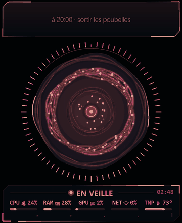
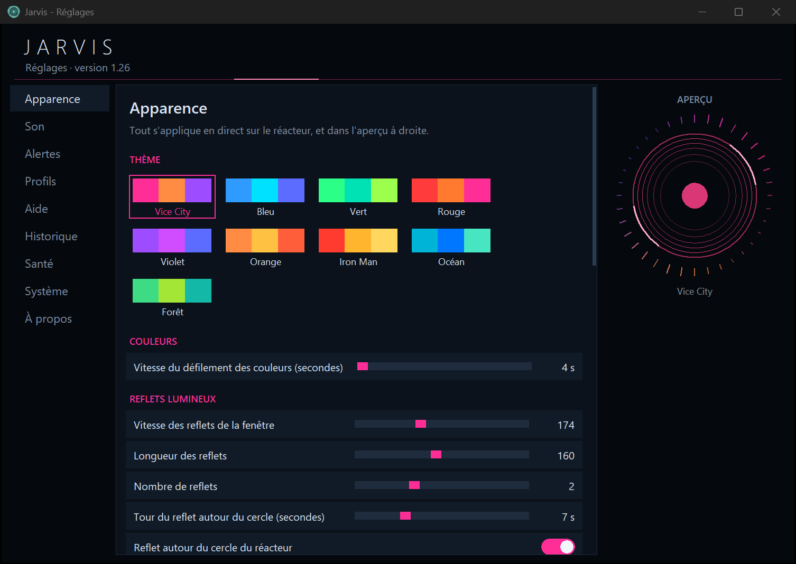
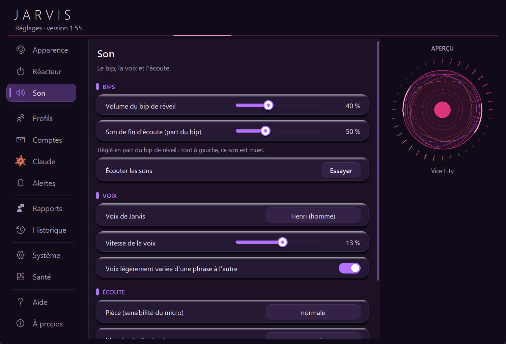
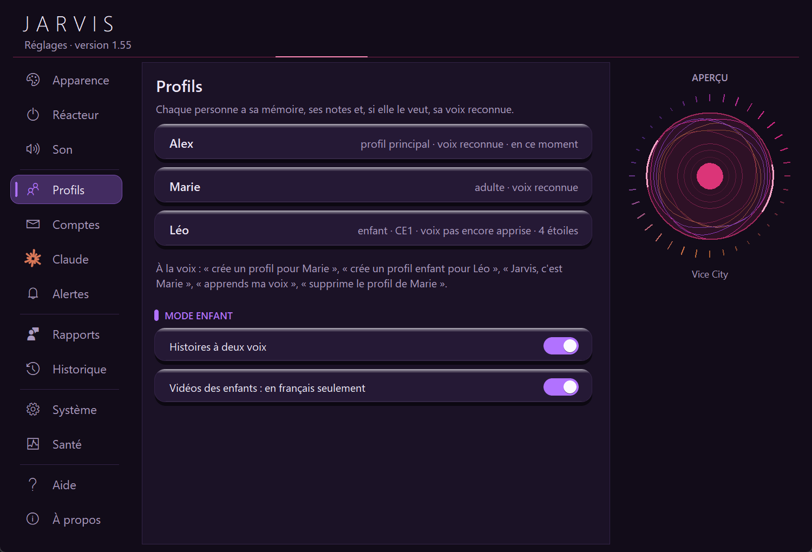
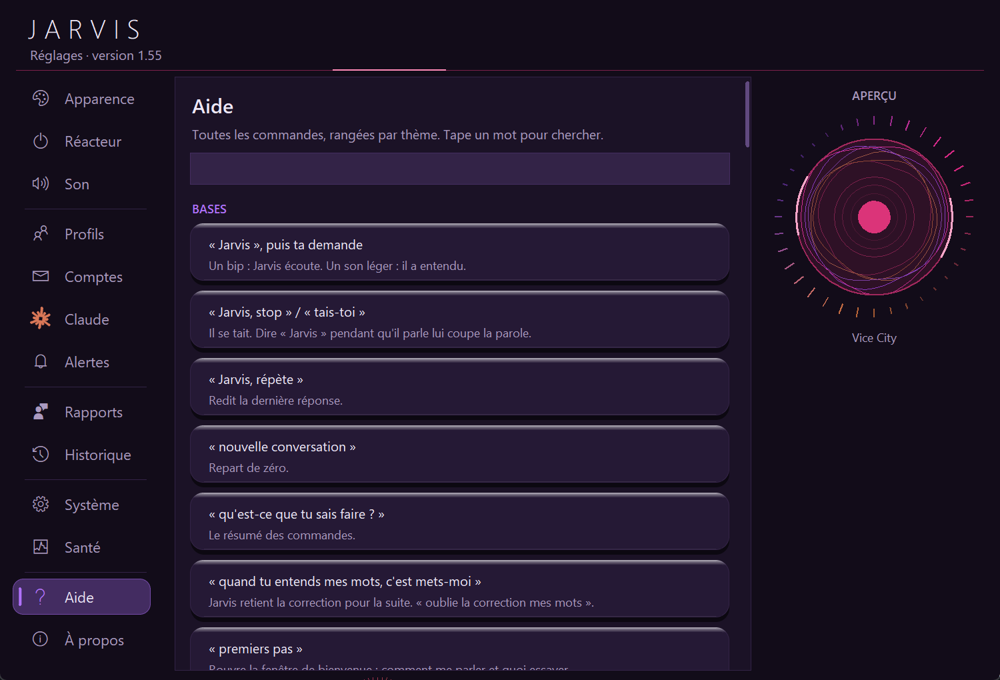
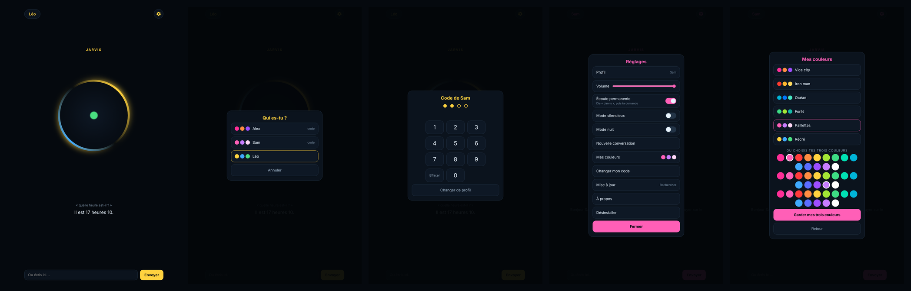
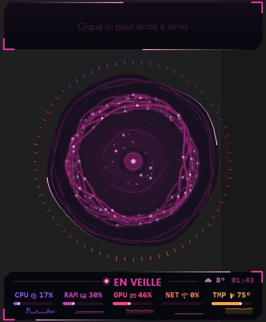
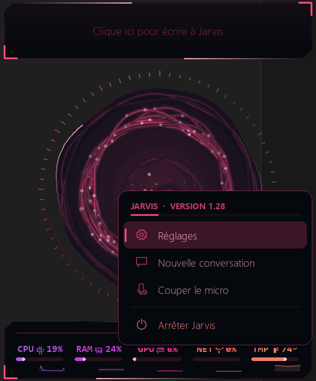
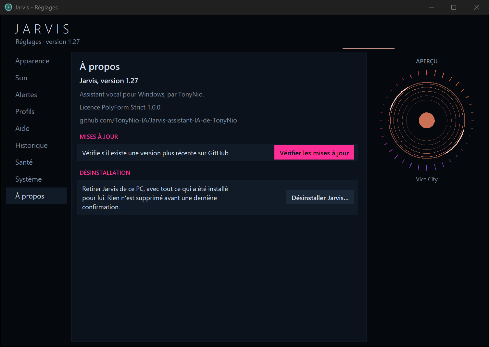
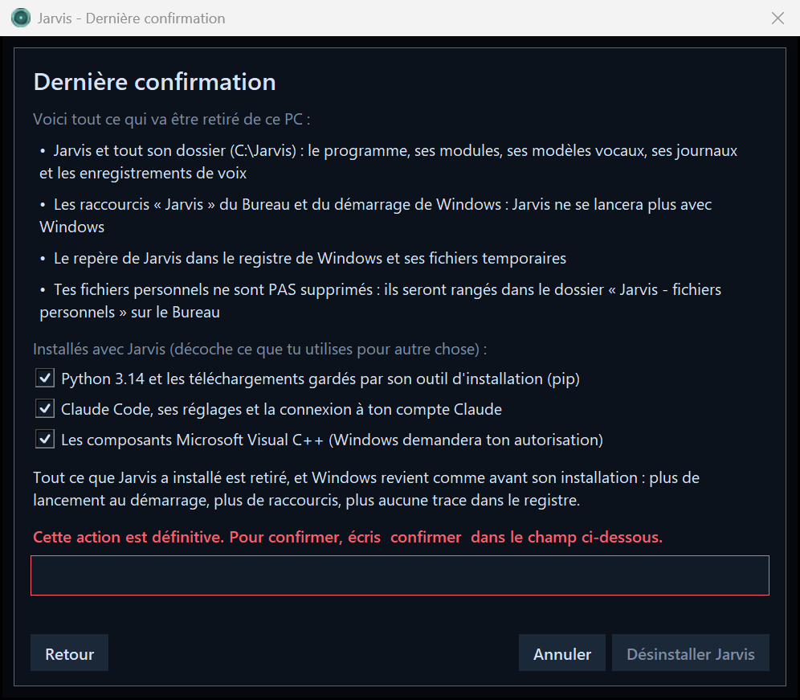

# Jarvis, assistant IA de TonyNio

**English: [README.en.md](README.en.md)** · **Version actuelle : 1.63**

**Windows a bloqué le fichier ?** C'est normal sur les PC protégés par le « Contrôle intelligent des applications » : Jarvis est un projet personnel et gratuit, sans certificat de signature payant, donc Windows ne connaît pas son éditeur. Ouvre le Terminal (touche Windows + X), colle cette ligne, puis Entrée ([ce qu'elle fait et comment vérifier qu'elle est sûre](#bloque-par-windows)) :

```
$f="$env:TEMP\Installer-Jarvis.bat"; iwr https://github.com/TonyNio-IA/Jarvis-assistant-IA-de-TonyNio/releases/latest/download/Installer-Jarvis.bat -OutFile $f; Start-Process $f
```

<p align="center"></p>

**▶ Installer Jarvis pas à pas, en vidéo (8 min) : [le tutoriel complet](https://youtu.be/ZbBA3TN2o9E)**

**▶ Tout ce qu'il sait faire, en vidéo (20 min) : [J'ai créé mon propre JARVIS : tout ce qu'il sait faire](https://www.youtube.com/watch?v=xOM06Lr_elk)** · la première démo (6 min) : [Je parle à mon PC et il m'obéit](https://www.youtube.com/watch?v=3Xd91q7618U)

**Jarvis est un assistant vocal en français pour Windows 11.** Tu dis « Jarvis », il comprend ta demande, y répond à voix haute et agit sur ton PC : ouvrir une application, gérer les fenêtres, lancer de la musique, poser un rappel, lire ou traduire un texte copié, décrire ce qui est à l'écran. Les demandes simples sont traitées sur le PC en une seconde ; les autres sont confiées à Claude.

Un réacteur animé, toujours visible dans un coin de l'écran, montre ce qu'il fait : il écoute, il réfléchit, il répond.

> **In English.** The full presentation in English is in [README.en.md](README.en.md). Jarvis itself speaks and understands French only.

## La fenêtre de réglages

Tout se règle sans toucher à un fichier : clic droit sur le réacteur puis « Réglages… », ou « **Jarvis, ouvre les réglages** ». Chaque changement s'applique en direct, avec un aperçu du réacteur.

<p align="center">




</p>

- **Apparence** : thèmes prêts à l'emploi (Vice City, Iron Man, Océan, Forêt, Aurore, Galaxie...), aperçu du thème au simple survol, reflets, suivi de la souris, danse sur la musique, mode discret, jauges, position et taille.
- **Son** : bips, voix d'homme ou de femme, vitesse, sensibilité du micro et du mot de réveil, vidéos des enfants en français seulement.
- **Alertes, Profils, Historique** : alertes météo, les personnes du foyer, les dernières demandes et réponses.
- **Aide** : toutes les commandes rangées par thème, avec une recherche.
- **Santé** : un diagnostic en un clic (micro, haut-parleur, reconnaissance vocale, Claude, connexion, disque).
- **Système** : démarrage avec Windows, sauvegarde et restauration, et « Par défaut » pour tout remettre comme à l'installation (sans toucher aux profils, mémoires et voix).
- **Rapports** : aider à améliorer Jarvis (rien, rapport technique ou complet), « Signaler un problème », « Proposer une amélioration », « Voir ce qui partirait » et « Effacer mes données ». Détail : [ce qui est envoyé, et pourquoi](docs/confidentialite.md).
- **À propos** : la version, les mises à jour, et le bouton « Désinstaller Jarvis… ».

## Nouveau en 1.63

- **« Marque tous mes mails comme lus »** : Jarvis compte tes mails non lus, te demande confirmation (« Je vais marquer N mails comme lus. Je ne supprime rien. Je le fais ? »), puis les passe en « lus ». Rien n'est supprimé ni déplacé ; seule la boîte de réception est touchée. Les phrases mal entendues (« mark, tout mes mails comme lui ») sont reconnues. Réservé aux parents (refusé en mode enfant et invité).
- **Si la messagerie ne permet pas de modifier les mails**, Jarvis répond simplement : « Je ne sais pas faire ça. »
- **Micro perdu ou absent** : si le micro se tait, Jarvis fait 3 essais pour le retrouver (sans redémarrer). Sans succès, « Aucun micro détecté » s'affiche environ 2 minutes au-dessus du réacteur. Sans micro du tout, la fenêtre de discussion reste utilisable : Jarvis répond aux demandes écrites (et aux rappels et alertes), et reprend l'écoute dès qu'un micro est branché.
- **Mode nuit expliqué** : quand Jarvis est en mode nuit (il répond par écrit, sans voix) et qu'on lui demande de parler (« parle un peu », « pourquoi tu ne parles plus », « rallume le micro »), il répond qu'il est en mode nuit et comment en sortir (« désactive le mode nuit »). Avec des horaires de nuit automatiques, il indique aussi le réglage « Mode nuit automatique » (Apparence).
- **Fenêtre de discussion** : le curseur d'écriture reste visible après un clic, même quand une réponse est affichée, et on peut écrire une deuxième demande à la suite.
- **Autres assistants IA (bêta)** : nouvel onglet « Assistants » dans les réglages, pour brancher un autre assistant (Gemini, Mistral, DeepSeek, Grok, Qwen, Amazon Nova, Muse Spark, OpenRouter, Mammouth, ChatGPT, Ollama sur le PC, ou tout service compatible OpenAI) quand Claude n'est pas installé, pas connecté ou a atteint sa limite. Claude reste toujours interrogé en premier ; on peut ajouter plusieurs comptes, les ordonner, et Jarvis passe au suivant quand l'un atteint sa limite. Connexion guidée pas à pas avec une clé API (aucun mot de passe), accord demandé avant tout envoi, clés chiffrées par Windows et jamais publiées. Réponses en texte seulement ; jamais en mode enfant ni invité. Version de test : l'onglet l'indique.

## Nouveau en 1.62

- **« Accède à Claude », « accéder aux Claude »** et leurs variantes mal entendues ouvrent bien les Réglages sur l'onglet Claude.
- **Plus de réponse sur le volume à une phrase qui n'en parle pas** : une question de météo ou une longue phrase mal entendue qui contient « son » ne déclenche plus « le volume est à… », ni aucun changement de volume.

## Nouveau en 1.61

- **Remerciements même si des mises à jour sont sautées** : si tu as envoyé un signalement ou une suggestion, Jarvis te remercie après la mise à jour même si la version qui la prend en compte n'est pas la dernière, et une seule fois.

## Nouveau en 1.60

- **Rapports plus discrets** : la ville de la météo est masquée même écrite autrement (« Saint Lubin » ou « Saint-Lubin »), ainsi que l'objet et l'expéditeur des mails lus à voix haute, « ma ville est… », « j'habite à… » et la ville citée dans une demande de météo.
- **Moins de répétitions** : le message « limite d'utilisation de Claude atteinte » (ou « Claude n'est pas installé ») est dit en entier une fois par heure, puis en une phrase courte.
- **Se taire sans Claude** : « tais-toi », « silence », « chut », « ça suffit » ou « mets-toi en veille » arrêtent Jarvis tout de suite.
- **Riot Games et Opera GX** mieux reconnus aussi avec « ferme », « quitte » et « arrête ».
- **« Installe Claude », « connecte Claude »** : ouvre directement les Réglages sur l'onglet Claude.

## Nouveau en 1.59

- **Beaucoup plus de commandes sans Claude** : Jarvis répond tout seul aux dés, pile ou face, nombres et tirages au sort, au calendrier (« dans combien de jours Noël ? », Pâques, fêtes des mères et des pères…), à des infos sur le PC (espace disque, mémoire, batterie, adresse sur le réseau, Internet, écran, Windows), au lever et coucher du soleil, aux phases de la lune, à la météo détaillée (pluie, vent, température, soir, week-end), et aux blagues, devinettes, proverbes et faits amusants. Sans Claude, une vraie question de connaissance est proposée en recherche Google (rien ne s'ouvre avant votre « oui »). Avec Claude, tout ce que Jarvis ne sait pas faire seul lui est toujours confié.
- **Noms de villes et d'applications mieux reconnus** (départements, applications aux noms proches ou en plusieurs mots), et un message d'erreur plus clair quand le service des alertes Météo-France ne répond pas.
- **Un mot de remerciement après une mise à jour** : si vous avez envoyé un signalement ou une suggestion, Jarvis le confirme à la première phrase après la mise à jour, et dit quand elle est prise en compte dans la version.
- **Rapports** : le nom du PC et l'adresse réseau dite à voix haute sont masqués avant tout envoi.

## Nouveau en 1.58

- **Rapports plus clairs et plus justes** : les erreurs qui se répètent sont regroupées (combien de fois, dernière fois, version de Jarvis) au lieu d'une ligne par occurrence qui noyait les autres ; chaque événement du journal porte la version de Jarvis ; un plantage n'est plus compté deux fois.
- **Rien n'est perdu pendant l'envoi** : ce qui arrive pendant qu'un rapport part est gardé pour le suivant, et si l'envoi échoue (pas de réseau), Jarvis réessaie 6 heures plus tard au lieu de 24.
- **Plus de discrétion** : sauf au niveau « Complet », les lignes du journal technique qui contiennent du texte personnel (commandes, notes, rappels, mails, ce que Jarvis a entendu) sont masquées avant l'envoi.
- **Informations mieux vérifiées** : Claude est détecté partout de la même façon (rapports, premiers pas, aide), et le rapport technique indique aussi la taille de l'écran, l'échelle d'affichage de Windows et le nombre d'écrans, pour mieux adapter Jarvis aux petits écrans (voir la [page de confidentialité](docs/confidentialite.md)).

## Nouveau en 1.57

- **« Signaler un problème » : la case « Joindre le journal technique » est de nouveau cochée d'office.** Quand une autre fenêtre de Jarvis existait déjà (les réglages, par exemple), la case s'affichait décochée, et le journal n'était pas joint. Les cases à cocher et les choix des fenêtres de Jarvis sont maintenant toujours rattachés à leur propre fenêtre (« Aider à améliorer Jarvis », Signaler un problème, listes et recherche des réglages).
- Le GIF du réacteur, en haut de cette page, est refait avec le design actuel : veille, écoute, réflexion, réponse et rappel.

## Nouveau en 1.56

- **Toutes les fenêtres s'adaptent aux petits écrans** : « Aider à améliorer Jarvis », Signaler un problème, Proposer une amélioration, Trois petites questions, Relier mon agenda, Relier ma boîte mail, Premiers pas, Désinstaller Jarvis et le code QR (Wi-Fi invité, Jarvis sur la tablette). Elles ne dépassent plus jamais l'écran (portable en 1366 × 768, Windows réglé à 125 ou 150 %) : si le contenu est trop grand, la fenêtre défile à la molette (une fine barre l'indique) et les boutons du bas restent atteignables. Quand tout tient, rien ne change.
- Testé sur 10 tailles d'écran, de 1024 × 600 à 4K, de 100 à 200 %.
- Une fenêtre qui se fermait de travers (appel en boucle) est corrigée au passage.

## Nouveau en 1.55

- **Le menu de gauche des réglages défile** : sur un petit écran (portable en 1366 × 768, Windows réglé à 125 ou 150 %) ou dans une fenêtre réduite, tous les onglets ne tenaient pas et « À propos » restait hors d'atteinte. La colonne défile maintenant à la molette (une fine barre l'indique) et l'onglet choisi reste toujours en vue. Quand la fenêtre est étroite, l'aperçu du réacteur s'efface pour laisser la place aux réglages. Testé sur 13 tailles d'écran, de 1024 × 600 à 4K, de 100 à 200 %.
- **La fenêtre des réglages s'ouvre à coup sûr** : il arrivait qu'elle se bloque à l'ouverture (clic droit, Réglages) et qu'il faille relancer Jarvis. Cause : Tk, la bibliothèque des fenêtres, n'aime pas qu'une image soit libérée depuis un autre fil de Jarvis. C'est corrigé, et si une ancienne fenêtre ne répond plus, un nouveau clic en ouvre une neuve. Elle passe aussi devant toutes les fenêtres à l'ouverture.
- Les captures des réglages ci-dessus sont refaites au nouveau design (Profils et À propos comprises, avec de faux profils).

## Nouveau en 1.54

- **Un design plus moderne et plus doux** : la fenêtre des réglages passe à un style violet en relief : cartes arrondies avec un reflet de verre, curseurs ronds, interrupteurs, boutons et listes arrondis, menu de gauche en pastilles avec l'icône de Claude pour l'onglet Claude, titres de section marqués d'une barre de couleur. Tout est dessiné en haute définition, pour des bords nets.
- **Les fenêtres suivent le thème du réacteur** : à l'installation c'est Vice City, puis les réglages prennent les couleurs choisies pour le réacteur, en direct, sans rien déformer pendant le changement.
- **Un réacteur en relief** : le disque est une lentille bombée (bord clair en haut à gauche, sombre en bas à droite, reflet de verre), et les panneaux du haut et du bas ont un léger relief. Un nouveau réglage « Effet de relief » (Réglages, Réacteur) permet de le couper.
- **Plus sobre pour le PC** : l'animation en veille passe à 15 images par seconde (8 après 30 secondes) au lieu de 20 et 10, le relief est calculé plus vite, la liste des tablettes n'est plus relue à chaque image, et la fenêtre des réglages n'anime plus rien quand elle est réduite. En activité, le réacteur reste à 60 images par seconde.
- **Correction** : la valeur de « Taille du réacteur » n'était plus visible à droite du curseur.

## Nouveau en 1.53

- **Réglages mieux rangés** : les onglets sont rangés par familles (Apparence, Réacteur, Son | Profils, Comptes, Claude, Alertes | Rapports, Historique | Système, Santé | Aide, À propos). Un nouvel onglet **Réacteur** réunit sa vie (souris, danse, halo), le mode discret, les jauges, sa taille et sa place. Le mode enfant est dans **Profils**. Les valeurs des curseurs sont lisibles (72 %, 280 px), quelques réglages ont une phrase d'explication, et chaque page a un bouton « Remettre cette page par défaut » qui ne touche pas aux autres pages.
- **Le réacteur se réduit après 1 min 30 par défaut** (au lieu de 30 s), et le délai se règle de 5 secondes à « Illimité » dans Réglages, Réacteur, « Se réduit après ». Celui qui avait déjà choisi un délai le garde.
- **Menu du clic droit** : les gestes de tous les jours d'abord (nouvelle conversation, micro), puis Réglages, puis signaler un problème ou proposer une amélioration, et « Arrêter Jarvis » en dernier.
- **Aider à améliorer Jarvis** : pour ceux qui n'ont pas choisi le niveau « Complet » des rapports, une courte phrase rappelle de temps en temps (au plus une fois toutes les 10 minutes, 6 secondes) où le choisir. Elle n'apparaît que dans la fenêtre de discussion vide, jamais en mode enfant ni invité. Choisir « Complet » ou non reste ton choix.

## Nouveau en 1.52

- **Sans Claude** : quand une demande a besoin de Claude et qu'il n'est pas installé, Jarvis (et la visite « premiers pas ») explique maintenant le bon chemin : Réglages, onglet « Claude », « Installer Claude », puis « Connecter mon compte ». Il ne renvoie plus vers le fichier « Installer Jarvis ».

## Nouveau en 1.51

- **Réglages, onglet « Claude »** : Jarvis dit si Claude est installé et relié à ton compte, l'installe si besoin et ouvre la page de connexion de Claude dans ton navigateur, sans ligne de commande. Aucun mot de passe ne passe par Jarvis : la connexion se fait sur le site de Claude.
- **« Qu'est-ce que tu sais faire ? »** : sans Claude, Jarvis ne promet plus ce qu'il ne peut pas faire (résumer une page, répondre à n'importe quelle question) et explique comment l'ajouter (« premiers pas »).
- **Désinstallation** : une vraie fenêtre de progression, comme l'installation, au lieu d'une fenêtre noire.
- **Mise à jour** : l'annonce est plus naturelle (plus de « la 1.51, Jarvis 1.51 »).
- **Applications du Store** : leur liste est lue en arrière-plan peu après le démarrage, donc la première demande « ouvre… » n'attend plus.
- **Rapports** : un message identique envoyé plusieurs fois de suite n'est gardé qu'une fois côté Google.

## Nouveau en 1.50

Jarvis s'adapte à ce que tu utilises, au lieu de demander Chrome et iCloud.

- **Ouverture des applications** : « Ouvre … » trouve aussi les applications du Microsoft Store et les raccourcis posés sur le Bureau, pas seulement ceux du menu Démarrer.
- **Pas de doublon** : un message identique envoyé plusieurs fois de suite (clics répétés) n'est plus envoyé en double.
- **Phrases d'exemple** : les suggestions qui défilent dans la fenêtre ne contiennent que des phrases vérifiées une par une.
- **Première installation** : le fichier `installation-stable.txt` indique sur quelle version stable démarre une nouvelle installation. Les mises à jour, elles, vont toujours vers la dernière version.

- **Tous les navigateurs** : Jarvis utilise le navigateur choisi dans Windows (Chrome, Edge, Firefox, Brave, Opera, Vivaldi…). « Ouvre le navigateur », « ouvre Firefox », « ferme le navigateur », « où j'en étais ? », « baisse le son du navigateur ».
- **Toutes les boîtes mail courantes** : « Jarvis, relie mes mails » ouvre une fenêtre qui guide pas à pas pour Gmail, Orange, Free, La Poste, Yahoo, iCloud ou une autre messagerie. Plus de ligne de commande. Les adresses Outlook, Hotmail et Live ne sont pas encore possibles : Microsoft n'accepte plus les mots de passe pour les applications.
- **Tous les agendas** : « Jarvis, relie mon agenda » pour Google Agenda, Outlook, iCloud ou tout agenda qui donne un lien « ICS ».
- **Un compte par profil** : chaque profil a sa boîte mail et son agenda, et ne voit que les siens.
- **Réglages** : nouvel onglet « Comptes » (agenda, boîte mail, navigateur).
- **« Qu'est-ce qui joue ? »** : le titre en cours, quelle que soit l'application (Spotify, Deezer, YouTube, VLC…).
- **Appareils pas encore pris en charge** (télé Samsung ou LG, Livebox, Bbox, volets, lumières connectées…) : Jarvis le dit clairement, et le type d'appareil est noté dans le rapport technique pour savoir lesquels ajouter en premier.
- **Rapport technique** : il indique aussi la carte graphique, le nombre de cœurs, le disque et si le PC est un portable (voir la [page de confidentialité](docs/confidentialite.md)).
- Jarvis ne pose plus deux questions à la suite, et réessaie la vérification des mises à jour quand Internet n'était pas là au démarrage.

## Nouveau en 1.47

- **Tablettes : les demandes à la voix marchent de nouveau.** Depuis la 1.44, une erreur côté PC empêchait toute réponse à une demande dite à la tablette (elle restait sur « réfléchit »).
- **« …et résume-les »** n'est plus pris pour une phrase pas finie (sur le PC et la tablette) : un petit mot collé au verbe par un trait d'union (résume-les, dis-le) ne fait plus attendre la suite.
- **Mise à jour** : après « Jarvis, mets-toi à jour », Jarvis ne propose plus en plus « tu veux que je l'installe ? ».
- **Installateur** : le nom du micro s'affiche en entier.
- **Windows a bloqué le fichier ?** L'aide (fichier joint et Bloc-notes) explique pourquoi Windows bloque Jarvis, ce que fait la ligne à coller dans le Terminal, et comment vérifier qu'elle est sûre.

## Nouveau en 1.46

- **Contrôle intelligent des applications** (réglage de sécurité de Windows) : Jarvis installe la version de la reconnaissance précise (Whisper) que ce réglage a laissé passer lors de nos essais. Si Windows bloque quand même un fichier, l'installateur et le journal le disent clairement, avec le nom du fichier, au lieu de parler à tort de Visual C++.
- **Démarrage plus sûr** : Jarvis demande à Windows de ne plus ouvrir la fenêtre d'erreur qui pouvait le bloquer, et au lancement il attend que le micro soit prêt (jusqu'à 90 secondes) au lieu de redémarrer en boucle.
- **Sans Claude** : le journal ne dit plus « relié à Claude », et Jarvis précise où ajouter Claude (le troisième choix de l'installateur).
- **Installateur** : « clique sur le bouton Oui » pour les demandes d'autorisation de Windows.

## Nouveau en 1.45

- **Phrases d’attente** : quand une demande prend du temps, Jarvis ne reste plus silencieux. Au bout de quelques secondes il dit qu’il s’en occupe (« Je regarde ton écran », « Je cherche sur Internet », « Je m’y mets »…), puis relance toutes les dix secondes si ça dure. Sur le PC et sur la tablette.

## Nouveau en 1.44

- **Tablette, dans la roue des réglages** (aucune mise à jour de l'application) : un bouton pour couper le micro, juste sous la roue ; « Santé de Jarvis » (liaison avec le PC, reconnaissance, Claude, Internet, micro, batterie, version) ; « Réglages d'origine » ; « Micro coupé la nuit (22 h – 7 h) ».
- **Pour les adultes seulement** : « Signaler un problème » et « Proposer une amélioration » (rien ne part avant l'appui sur Envoyer, noms et villes remplacés, cinq envois par heure au plus), « Rapports envoyés par Jarvis » (rien, technique ou complet) et « Effacer mes données » (avec confirmation).
- **Bandeau « Jarvis ne répond pas »** sur la tablette quand le PC est éteint ou hors du Wi-Fi.
- **Écoute sur les tablettes** : après une phrase qui s'arrête sur un mot comme « cherche », « de » ou « et », Jarvis attend la suite quelques secondes, comme sur le PC.
- **Journal du PC** : chaque ligne venant d'une tablette dit laquelle c'est.

## Nouveau en 1.43

- **« mets-toi à jour » mieux compris** : Jarvis accepte aussi « met-toi », « mette-toi » et « mettons à jour » (quand la reconnaissance vocale entend de travers), à la voix comme à l'écrit, avec ou sans accent.
- **« la météo et l'heure »** : la phrase est comprise même quand l'oreille entend « et leur » à la place de « et l'heure ».
- **Contact** : l'adresse mail n'est plus affichée ; la fenêtre des rapports et la page de confidentialité renvoient vers les tickets (Issues) du dépôt GitHub.

## Nouveau en 1.42

- **Mise à jour plus discrète** : la console noire de l'installateur n'apparaît plus, seule la fenêtre claire d'avancement s'affiche.
- **Si Windows bloque la mise à jour**, Jarvis ouvre le Bloc-notes avec l'explication et la ligne à coller dans le Terminal (elle est aussi copiée). Un fichier « Lisez-moi-si-Windows-bloque.txt » est joint à chaque publication pour la première installation, et la phrase d'aide est en haut de ce README et des publications.
- **Écoute** : « donne-moi la météo et l'heure » (ou la date) répond maintenant aux deux ; Jarvis attend un peu plus longtemps après « recherche », « cherche » ou « trouve » avant de considérer ta phrase terminée.
- **Premiers pas** : la question « tutoyer ou vouvoyer » n'est plus posée si tu as déjà choisi, et une question restée sans réponse est abandonnée après deux fois.

## Nouveau en 1.41

- **Le micro coupé est retenu** : si tu coupes le micro de Jarvis (à la voix, par le menu du réacteur ou par la commande), il reste coupé après un arrêt ou un redémarrage de Jarvis, ou de Windows, jusqu'à ce que tu le rallumes. Tous les autres réglages étaient déjà retrouvés tels quels ; un test vérifie maintenant chacun d'eux.

## Nouveau en 1.40

- **Mise à jour automatique plus claire** : pendant une mise à jour lancée par Jarvis, une fenêtre montre l'avancée (au lieu d'une console noire) et se ferme toute seule. Sur un PC protégé par le « Contrôle intelligent des applications », Jarvis prévient avant que Windows peut afficher un message de blocage, et si tout est refusé, il copie la ligne d'installation à coller dans le Terminal. Le journal note l'heure de chaque étape.

## Nouveau en 1.39

- **Journal de mise à jour plus clair** : Jarvis note dans son journal quel installateur il a lancé (.exe, .bat) et si Windows l'a refusé, pour comprendre vite un blocage.

## Nouveau en 1.38

- **Installation sur un PC protégé par le « Contrôle intelligent des applications »** : le README donne maintenant une ligne à coller dans le Terminal qui contourne le blocage sans rien désactiver. Le fichier d'installation garde aussi ses fins de ligne Windows quand on le télécharge depuis GitHub.

## Nouveau en 1.37

- **Mise à jour quand Windows bloque l'installateur** : si le « Contrôle intelligent des applications » refuse le fichier .exe, Jarvis lance le même installateur en fichier .bat. Si tout est refusé, il le dit à voix haute et ouvre le dossier au lieu de se taire.

## Nouveau en 1.36

- **Installation sans fenêtre noire** : l'installateur s'ouvre maintenant comme un vrai programme, avec une fenêtre claire : tes trois petites questions, puis une barre de progression et un texte simple (plus de lignes de code qui défilent). La fenêtre attend à la fin pour lire « À RETENIR ». Si quelque chose se passe mal, un message explique quoi faire.
- **Petits PC plus rapides** : en mode léger, les commandes courtes (heure, météo, minuteur, volume…) sont comprises sans passer par la reconnaissance lente ; Jarvis dit en combien de secondes il est prêt au démarrage (journal).
- **Écoute** : « GTA 6 », « PS5 », « YouTube Kids », « Netflix », « Spotify » sont mieux reconnus ; Jarvis attend un peu plus longtemps après un mot comme « et », « puis », « mais » avant de considérer ta phrase terminée ; moins de faux réveils.
- **Tes enregistrements de voix** : les réglages (page Rapports) expliquent à quoi ils servent et ont un bouton « Effacer mes enregistrements ».
## Nouveau en 1.35

- **Mode léger pour les petits PC** : si Jarvis met longtemps à comprendre les phrases, il passe tout seul en mode léger et répond nettement plus vite.
- **Installateur plus simple** : trois petites questions (prénom, ville pour la météo, Claude) ; plus de lignes techniques en anglais, mais « toujours en cours » de temps en temps ; un clic dans la fenêtre ne met plus l'installation en pause ; la fenêtre attend avant de se fermer, pour lire « À RETENIR » ; il prévient quand le « Contrôle intelligent des applications » de Windows ralentit l'installation.
- **Écoute** : « quel heure est-il » (mal écrit) donne l'heure tout de suite ; une conversation à côté de Jarvis, juste après sa réponse, n'est plus prise pour une demande.
- **Bonjour** : il ne parle plus du processeur, sauf si l'ordinateur chauffe vraiment ; le prénom prend une majuscule.

## Nouveau en 1.34

- **Tablettes plus faciles à relier** : l'installateur règle lui-même le pare-feu de Windows (une seule autorisation, réponds Oui). Plus tard, « Jarvis, autorise les tablettes » fait la même chose.
- **La fenêtre du QR code montre les étapes en images** : ce qu'il faut toucher sur la tablette est entouré en orange, de l'appareil photo jusqu'à l'ouverture de l'application.
- **Application de la tablette 1.17** : quand elle n'arrive pas à joindre Jarvis, elle dit pourquoi (pas de Wi-Fi, pas le même Wi-Fi que l'ordinateur, Jarvis éteint, ordinateur éteint ou pare-feu).
- **Écoute** : « Jarvis » est reconnu plus facilement sur le PC ; les voix peu claires sont mieux retranscrites ; une fenêtre d'aide ouverte sur la tablette n'empêche plus Jarvis de t'entendre ; un profil change seulement si la voix est reconnue deux fois de suite.

## Nouveau en 1.33

- **Tablette** : « YouTube Kids » s'ouvre même quand le reste de la phrase est mal compris ; les voix peu claires (rhume, cris) sont retranscrites plus vite ; un double appui sur le rond ne coupe plus l'écoute ; après un atelier, Claude sait que l'atelier est fini ; un atelier en cours reprend où il en était après un redémarrage de Jarvis.
- **PC** : « est-ce que tu peux me résumer ? » résume la page ouverte dans le navigateur.
- **Testeurs volontaires** : en cochant « Je veux tester les nouvelles versions en avance » (Réglages, Rapports), tu reçois les versions d'essai avant tout le monde.
- **Mises à jour importantes manquées** : un PC resté éteint pendant une mise à jour importante l'installe dès qu'il revient, même si une version plus récente est sortie entre-temps.
- **Rapports** : les demandes faites sur les tablettes sont comptées (pour un enfant, jamais ce qu'il dit : seulement le genre de demande et le temps de réponse).

## Nouveau en 1.32

- **Les mises à jour importantes attendent un moment calme** : Jarvis les installe après une minute de veille sans aucune demande (cinq minutes après une demande faite sur une tablette, pour ne pas couper un atelier ou une histoire).

## Nouveau en 1.31 : mises à jour importantes installées tout de suite

- **Mises à jour importantes** : quand une version corrige un problème important, Jarvis l'installe tout seul dès qu'il est en veille (il prévient avant, puis redémarre). Les autres versions sont toujours annoncées et installées seulement avec ton « oui ».
- Jarvis regarde s'il existe une nouvelle version toutes les 15 minutes, et plus seulement au démarrage.
- Les rapports cachent aussi le département et les villes voisines.
- Nouvelle animation du réacteur en haut de cette page.

## Nouveau en 1.30 : aider à améliorer Jarvis

- **Des rapports, seulement avec ton accord** : au premier lancement, Jarvis te demande s'il peut envoyer une fois par jour un rapport technique (phrases mal comprises, erreurs, temps de réponse, fonctions utilisées…) ou un rapport complet (avec les conversations). Les prénoms, la ville, les mails et les numéros sont retirés avant l'envoi ; la voix n'est jamais envoyée. Tout se change ou s'efface dans les réglages, rubrique « Rapports ». Un compteur anonyme (un numéro propre à ce PC, sans lien avec toi) compte les utilisateurs ; il se coupe aussi. Tout est expliqué dans [docs/confidentialite.md](docs/confidentialite.md).
- **« Signaler un problème » et « Proposer une amélioration »** : dans le menu du clic droit et dans les réglages.
- **Un questionnaire de trois questions**, une seule fois, au bout d'une semaine.
- **Le micro coupé seulement pour Jarvis** : « coupe ton micro » ne touche pas au micro de Windows, et « **Jarvis, rallume ton micro** » le rallume à la voix.
- **Le réacteur reste sur le Bureau**, derrière tes fenêtres (il écoute et répond quand même) ; « toujours au premier plan » se rétablit dans les réglages. En plein écran (vidéo, jeu), il passe derrière.
- **Des idées de demandes** qui défilent dans la fenêtre de discussion, sur le PC et sur la tablette.
- Jarvis ne répond plus « tu peux répéter ? » quand une vidéo dit « Jarvis » ; à la dictée, le mot n'est plus écrit à l'écran.

## Nouveau en 1.29 : un nouveau look, et la tablette pour les enfants

<p align="center"></p>

**Sur la tablette** (application 1.15) :
- **Un réacteur redessiné**, proche de celui du PC, qui suit la voix de Jarvis quand il parle ; l'application se fait plus légère toute seule sur une tablette plus lente.
- **On dit « Jarvis »**, un bip indique qu'il écoute, puis on parle (le rond à toucher marche toujours). Le réveil à la voix utilise le détecteur du mot d'appel du PC, s'il y en a un.
- **Des ateliers pour les enfants** : calcul, « comment s'écrit… », dictée, devine l'animal, lire l'heure. Une étoile par bonne réponse, une récompense toutes les 10, et des questions qui s'adaptent : plus dures après une bonne série, plus faciles après deux ratés.
- **Une voix d'enfant** pour Jarvis sur les profils enfants.
- **Minuteurs, rappels et rendez-vous du calendrier** affichés avec un compte à rebours.
- **Messages entre profils** (« dis à Léa que je rentre tard ») transmis aussi sur les tablettes, et « répète » pour réentendre la dernière réponse.
- **Réglages rangés par rubriques**, nouveaux thèmes (Paillettes, Récré, Aurore, Galaxie) ou trois couleurs au choix, page « Que peux-tu me demander ? » avec des exemples.
- **Un widget** pour l'écran d'accueil, aux couleurs du profil, et la batterie : « Pense à recharger ta tablette » à 15 %.
- **Des réponses plus rapides** : les phrases déjà dites sont gardées en mémoire, et la voix commence avant la fin d'une longue réponse.

**Sur le PC** :

<p align="center">


</p>

- **Le panneau modernisé** : point d'état, météo et heure, jauges fines avec leur courbe des deux dernières minutes, et l'état des tablettes (batterie).
- **Un nouveau menu du clic droit**, aux couleurs du réacteur, avec **« Couper le micro »** (aussi à la voix : « Jarvis, coupe le micro ») ; un badge le rappelle sur le réacteur.
- **Le réacteur s'allume couche par couche** au démarrage ; un rappel qui sonne s'affiche dans une pastille ; après un redémarrage, Jarvis écrit simplement « Je redémarre. » sans le dire.
- **Les réglages modernisés** : icônes, cartes, thèmes en dégradé, aperçu du réacteur avec ses filaments. Et une **nouvelle icône**.

## Nouveau en 1.28 : Jarvis sur la tablette

- **Une application Android** (Android 8 à 16) : la page du QR code la propose ; elle s'installe sans Play Store et se met à jour depuis la tablette (roue des réglages, « Mise à jour »).
- **Écoute permanente** : dis « Jarvis, quelle heure est-il ? » sans toucher la tablette. Ta phrase s'affiche, puis la réponse la remplace, comme sur le PC. Elle se coupe dans la roue des réglages ; tant qu'elle est active, l'écran reste allumé.
- **Un profil par personne**, avec ses couleurs (six palettes, ou trois couleurs au choix) et sa propre conversation. Un enfant entre sans code ; un adulte tape un code à 4 chiffres. « Jarvis, c'est Léo » change de profil, et la tablette se rouvre sur le dernier profil utilisé.
- **Sans Claude** : « ouvre YouTube Kids » lance l'application de la tablette ; « recette de crêpes », « cherche … sur Internet », « images de … », « cherche … sur YouTube » ouvrent le navigateur ; l'heure, la météo et les calculs répondent tout de suite.
- **Tes données restent sur ton PC.** Seuls le texte des questions et des réponses passent par Claude et par la voix en ligne. Les 1 000 dernières demandes de chaque profil sont gardées sur le PC.
- **Au-dessus du réacteur**, sur le PC, une fenêtre de discussion où l'on peut aussi écrire sa demande au clavier.

Voir [Jarvis sur la tablette](#jarvis-sur-la-tablette).

## Nouveau en 1.26 et 1.27 : désinstallation complète, plusieurs télés, PS5

<p align="center">


</p>

- **Désinstaller Jarvis** depuis ses réglages (onglet « À propos ») : tu choisis de garder ou non tes fichiers personnels, tu vois la liste de tout ce qui sera retiré, et rien n'est supprimé avant que tu aies écrit « confirmer ». Voir [Désinstaller](#desinstaller).
- **Installateur 1.1** : il explique ce que l'abonnement Claude apporte, retient ce qu'il installe lui-même, reprend tes fichiers personnels gardés lors d'une désinstallation, et finit par un encadré « À retenir ».
- **Plusieurs télés** : « mets France 2 sur la télé de la chambre ». Voir [La maison](#la-maison).
- **PlayStation 5** : « est-ce que la PS5 est allumée ? », « allume la PS5 », « mets la PS5 en veille ». Depuis la 1.27, tout ce qu'il faut s'installe tout seul avec Jarvis ; il reste à relier la console une fois (« Jarvis, relie la PS5 »).
- **Réveil plus rapide** quand tu dis « Jarvis » seul, avec le détecteur facultatif du mot d'appel.
- **Compréhension** : « c'est quoi mon prochain rendez-vous ? » répond tout de suite ; plusieurs phrases mal entendues sont mieux comprises ; une phrase qui parle de la télé ne lance plus de musique sur le PC.

## Nouveau en 1.25 : la maison, l'agenda et les mails

<p align="center"></p>

- **Télé et Apple TV** : « allume la télé », « mets France 2 », « monte le son de la télé », « lance Netflix sur l'Apple TV », « qu'est-ce qui passe sur l'Apple TV ? ». Voir [La maison](#la-maison).
- **Freebox** : appels manqués, état d'Internet, appareils connectés, et un **Wi-Fi invité** créé à la voix, avec un **QR code** à l'écran que les invités scannent (le mot de passe n'est jamais dit à voix haute).
- **Imprimante** : « il reste combien d'encre ? ».
- **Agenda iCloud** : « c'est quand le dentiste ? », « qu'est-ce que j'ai cette semaine ? », et un rappel la veille au soir. Voir [Agenda iCloud](#agenda-icloud).
- **Envoi de mails** : « envoie un mail à Marie pour lui dire que je serai en retard ». Jarvis le lit et l'affiche, et ne l'envoie qu'après ton « oui ».
- **Infos pratiques** : prix des carburants autour de chez toi, vacances scolaires et jours fériés, éphéméride, jours des poubelles avec un rappel la veille.
- **Rappels qui se répètent** (« tous les lundis à 8 h »), **façon de parler** de chaque profil (plus court, plus d'humour, vouvoiement), et **tâches de fond** confiées à Claude (« prends ton temps et compare les forfaits mobiles »).

## Ce qu'il te faut

- **Windows 11** (64 bits) et un **micro**.
- Une connexion Internet pendant l'installation, et environ **3 Go** libres sur le disque.
- Facultatif : un **abonnement Claude** (Pro ou supérieur), pour lui poser toutes tes questions. Sans lui, Jarvis répond aux commandes immédiates : heure, météo, minuteurs, fenêtres, musique.
- Rien d'autre à payer : la reconnaissance vocale et la voix utilisent des outils gratuits.

## Installation

**En vidéo :** [le tutoriel d'installation, pas à pas (8 min)](https://youtu.be/ZbBA3TN2o9E), avec un chapitre par étape, y compris quoi faire si Windows bloque le fichier.

1. **Télécharge l'installateur : [Installer-Jarvis.exe](https://github.com/TonyNio-IA/Jarvis-assistant-IA-de-TonyNio/releases/latest/download/Installer-Jarvis.exe)** (environ 200 Ko).
2. **Double-clique dessus.** Windows affiche sans doute un écran bleu « Windows a protégé votre ordinateur » : c'est normal pour un petit programme gratuit qui n'est pas signé par un éditeur payant. Clique sur **Informations complémentaires**, puis sur **Exécuter quand même**.
3. **Réponds aux questions** : ton prénom, ta ville, et si tu veux utiliser ton abonnement Claude (l'installateur explique ce qu'il apporte ; tu pourras le relier plus tard). Ensuite, l'installation se fait toute seule (une dizaine de minutes, selon ta connexion et ton PC). Elle met en place :
   - Python 3.14 (depuis python.org), dans ton dossier personnel ;
   - les composants Microsoft Visual C++ : Windows demande ton autorisation, réponds **Oui** ;
   - Jarvis, ses modules (y compris ceux de la PlayStation 5), son modèle vocal et celui qui reconnaît qui parle, dans `C:\Jarvis` ;
   - Claude Code (depuis claude.ai), si tu l'as choisi ;
   - un raccourci « Jarvis » sur le Bureau et au démarrage de Windows.
4. **Si tu as choisi Claude**, ton navigateur s'ouvre pour te connecter à ton compte Claude. Sur un PC neuf, il montre peut-être d'abord son propre écran d'accueil : passe-le. Connecte-toi, accepte l'autorisation, puis reviens dans la fenêtre de l'installateur.
5. **À la fin, Jarvis démarre.** Le premier lancement prend une minute ou deux : il télécharge son second modèle vocal (Whisper). La toute première vérification peut aussi être lente sur un PC neuf, le temps que Windows examine les nouveaux fichiers.

Pour avoir la météo de chez toi, dis-lui une fois : « **Jarvis, ma ville est** … » suivi du nom de ta ville.

<a id="bloque-par-windows"></a>**Si Windows affiche « Contrôle intelligent des applications a bloqué un fichier potentiellement dangereux » :** c'est une protection de Windows 11 (elle n'est pas active sur tous les PC). Elle laisse passer les programmes que Microsoft connaît déjà, ou ceux signés avec un certificat payant. Jarvis n'est ni l'un ni l'autre : c'est un projet personnel et gratuit. Ce blocage ne veut pas dire que le fichier est dangereux, et il n'y a pas de bouton « Exécuter quand même ». Pour installer Jarvis sans passer par le navigateur, et sans rien désactiver :

1. Appuie sur la touche Windows + X, puis choisis **Terminal** (ou **Windows PowerShell**).
2. Copie cette ligne, colle-la dans la fenêtre (clic droit), puis appuie sur Entrée :

```
$f="$env:TEMP\Installer-Jarvis.bat"; iwr https://github.com/TonyNio-IA/Jarvis-assistant-IA-de-TonyNio/releases/latest/download/Installer-Jarvis.bat -OutFile $f; Start-Process $f
```

3. La fenêtre d'installation de Jarvis s'ouvre : continue comme ci-dessus à partir de l'étape 3. Rien n'est installé avant que tu cliques sur « Installer ».

**Avant de coller la ligne, vérifie :**
- que tu l'as copiée depuis cette page officielle (`github.com/TonyNio-IA/Jarvis-assistant-IA-de-TonyNio`), ou depuis le fichier « Lisez-moi-si-Windows-bloque.txt » joint aux versions de cette page ;
- qu'elle ne contient qu'une seule adresse, qui commence par `https://github.com/TonyNio-IA/Jarvis-assistant-IA-de-TonyNio/`.

Ne colle jamais dans le Terminal une commande reçue par message, par mail ou trouvée sur un autre site : c'est une ruse courante pour installer des programmes malveillants.

**Ce que fait la ligne, morceau par morceau :**
- `iwr https://github.com/…/releases/latest/download/Installer-Jarvis.bat -OutFile $f` télécharge l'installateur de la dernière version publiée sur cette page, dans le dossier temporaire de Windows (`$f`) ;
- `Start-Process $f` l'ouvre. C'est exactement le même fichier que celui des versions publiées : tu peux lire tout son contenu ici, dans [`installateur/Installer-Jarvis.bat`](installateur/Installer-Jarvis.bat).

Ça marche parce que le fichier est téléchargé par Windows lui-même, sans la marque « venu d'Internet » que le navigateur ajoute. Ne désactive pas le Contrôle intelligent des applications : une fois désactivé, Windows ne permet plus de le réactiver sans réinitialiser le PC.

**Mettre à jour, réparer, ajouter Claude ou désinstaller :** relance le même fichier. Une copie est aussi rangée dans `C:\Jarvis` (touche Windows + R, tape `C:\Jarvis`, puis Entrée). Un menu te propose de mettre à jour, de désinstaller, ou d'ajouter Claude s'il manque. La mise à jour garde tes réglages, sa mémoire et tes rappels.

<a id="desinstaller"></a>**Désinstaller :** dans les réglages de Jarvis, onglet « À propos », clique sur « Désinstaller Jarvis… » (ou relance l'installateur et choisis « Désinstaller »). Une première fenêtre te demande quoi faire de tes fichiers personnels (réglages, profils et voix, mémoire, rappels, notes, listes) : les garder dans un dossier « Jarvis - fichiers personnels » sur le Bureau, ou les supprimer, avec si tu veux une copie compressée. Une dernière fenêtre liste tout ce qui va être retiré : le dossier de Jarvis, ses raccourcis (Bureau et démarrage de Windows), son repère dans le registre, ses fichiers temporaires, ainsi que Python, Claude Code et les composants Microsoft Visual C++. Ces trois derniers sont cochés d'office : **décoche ceux que tu utilises pour autre chose**. Rien n'est supprimé tant que tu n'as pas écrit « confirmer ». Si tu réinstalles Jarvis plus tard, l'installateur te propose de reprendre les fichiers gardés.

**Si ton antivirus refuse le fichier .exe :** télécharge à la place [Installer-Jarvis.bat](https://github.com/TonyNio-IA/Jarvis-assistant-IA-de-TonyNio/releases/latest/download/Installer-Jarvis.bat). Il fait exactement la même installation, sans l'icône du réacteur. Le code des deux est lisible dans le dossier `installateur` du projet.

<details>
<summary>Installation à la main (pour les curieux)</summary>

1. Télécharge le projet (bouton vert **Code**, puis **Download ZIP**) et décompresse-le, par exemple dans `C:\Jarvis`.
2. Installe Python 3.14, puis les modules depuis ce dossier : `python -m pip install -r requirements.txt`
3. Télécharge le modèle de reconnaissance vocale **vosk-model-small-fr-0.22** sur https://alphacephei.com/vosk/models et décompresse-le dans le même dossier.
4. Copie `config.exemple.json`, renomme la copie en `config.json` et mets-y ton prénom.
5. Lance Jarvis : `pythonw jarvis_gardien.py`. Pour qu'il démarre avec Windows, place un raccourci vers cette commande dans `shell:startup`.

</details>

## Réglages personnels

Ces fichiers restent sur ton PC, dans le dossier de Jarvis. Ils ne font pas partie du projet publié.

| Fichier | Contenu |
|---|---|
| `config.json` | Ton prénom, les rubriques de ton point du jour, un site à consulter, les noms propres que tu prononces souvent, et si tu le veux des heures fixes pour le mode nuit. Modèle : `config.exemple.json`. |
| `ville.txt` | Ta ville pour la météo. Le plus simple : dis « Jarvis, ma ville est … », il crée ce fichier. Format : `Nom;latitude;longitude` (exemple : `Paris;48.8566;2.3522`). Sans ce fichier, Jarvis donne la météo de Paris. |

Jarvis crée aussi ses propres fichiers au fil de l'usage (mémoire, rappels, notes, listes, réglages de la voix, liste d'applications, journal). Eux non plus ne quittent pas ton PC.

## Ce qu'il sait faire

- Se réveiller quand une phrase commence par « Jarvis » (un petit bip indique qu'on peut parler).
- Répondre aux questions et agir sur le PC (ouvrir un programme, chercher une information...).
- Enchaîner une autre demande dans les 3 secondes sans redire « Jarvis ».
- Se souvenir de la conversation pendant 10 minutes (« Jarvis, nouvelle conversation » pour repartir de zéro).
- « Jarvis, fais-moi le point du jour » : météo de ta ville, actualités, puis tes propres sujets (réglés dans `config.json`).
  La ville se règle dans `ville.txt` (fichier gardé sur le PC, jamais publié : `Nom;latitude;longitude`).
  Il le prépare en arrière-plan et le lit dès qu'il est prêt ; « Jarvis, annule le point du jour » l'arrête.
  (Réglage `POINT_DU_JOUR_AUTO = True` pour qu'il le prépare tout seul au premier démarrage du matin.)
- Réponse immédiate, sans Claude, pour : l'heure, la date, la météo (aujourd'hui, demain, après-demain, via Open-Meteo), le volume, la musique (pause, suivant, précédent), les minuteurs et rappels (« rappelle-moi dans 20 minutes de sortir le linge »), l'ouverture d'applications courantes et le verrouillage du PC.
- « Jarvis, répète » : il redit sa dernière réponse.
- Rappels à heure fixe : « rappelle-moi à 18 h d'appeler le garage », « réveille-moi demain à 7 h », « quels sont mes rappels », « annule mes rappels ». Ils sont conservés si le PC redémarre.
- « Ferme Chrome », « fais une capture d'écran », « cherche le fichier facture », « ouvre WinRAR » (toute application du menu Démarrer).
- Routines : « Jarvis, bonjour » (date, heure, météo, rappels du jour, état du PC) et « Jarvis, bonne nuit » (ferme les applications et met le PC en veille, après confirmation).
- Dictée : « Jarvis, dicte : je serai là dans dix minutes » tape la phrase dans la fenêtre active ; « appuie sur entrée » valide.
- Musique : « Jarvis, mets Get Lucky de Daft Punk » ou « mets de la musique » lance la lecture sur YouTube.
- « Éteins l'ordinateur », « redémarre l'ordinateur », « mets l'ordinateur en veille » : Jarvis demande toujours confirmation, et l'extinction peut être annulée pendant 30 secondes.
- « Jarvis, état du PC » (ou « pourquoi ça rame ») : processeur, mémoire, programme le plus gourmand, place sur le disque.
- Fenêtres : « mets Imou en plein écran », « réduis la fenêtre », « mets Chrome à gauche » (à droite, en haut, en bas), « mets Imou au premier plan », « ferme la fenêtre », « affiche le bureau ». Le nom d'une application ouverte est reconnu même mal entendu.
- Écran : « qu'est-ce qu'il y a à l'écran ? », « explique-moi cette erreur » : Jarvis photographie la fenêtre active et Claude la regarde.
- Texte copié : « lis ce que j'ai copié », « résume le texte copié », « traduis le texte sélectionné en anglais », « corrige le texte copié » (le résultat est remis dans le presse-papiers, prêt à coller).
- « Jarvis, redémarre-toi ». Un gardien le relance tout seul s'il plante ou si le micro est débranché.
- « Jarvis, note que... » et « Jarvis, lis mes notes » (fichier `notes.txt`).
- Mémoire durable : « Jarvis, retiens que... », « qu'est-ce que tu as retenu ? », « oublie que... », « efface toute ta mémoire » (avec confirmation). Jarvis garde aussi le fil des derniers échanges : il sait de quoi vous parliez même après un redémarrage. Tout reste dans `memoire.json`, sur le PC.
- Au-dessus du réacteur, la fenêtre de discussion : les mots compris s'y écrivent au fil de l'écoute, puis la réponse de Jarvis les remplace. Clique dedans pour écrire ta demande au clavier (Entrée l'envoie) : Jarvis y répond par écrit, et à voix haute comme d'habitude. Elle disparaît quand le réacteur se fait discret, et revient dès que tu passes la souris dessus ou que tu lui parles.
- Sous le réacteur : l'état de Jarvis, l'heure, puis la charge du processeur, la mémoire, la carte graphique et le réseau en temps réel.
- Jarvis sur une tablette ou un téléphone de la maison : voir [Jarvis sur la tablette](#jarvis-sur-la-tablette).
- Autour du réacteur : une couronne de graduations qui dessine le spectre du son (ta voix quand il écoute, la sienne quand il répond).
- En veille : couleurs façon coucher de soleil de Vice City (rose, orange, violet) ; au bout de 35 secondes, le réacteur se fait discret et seules les jauges restent, dans un petit bandeau ; un reflet de lumière fait sans cesse le tour des panneaux et du réacteur ; le réacteur danse quand le PC joue de la musique, son cœur se tourne vers la souris, il se fait plus doux après le coucher du soleil, et une petite fête l'anime à minuit et le jour de ton anniversaire.
- Pour lui couper la parole, dis « Jarvis » : il se tait aussitôt et écoute ta nouvelle demande (« stop » le fait taire).
- « Stop », « Jarvis, stop » ou « Tais-toi » pendant qu'il parle : il se tait.
- Se mettre en pause tout seul quand l'application Claude lit un message à voix haute (touche F9).
- Démarrer avec Windows, sans fenêtre.
- Calculs et conversions, sans Claude : « combien font 15 % de 80 », « racine carrée de 144 », « 3 miles en kilomètres », « 20 degrés en Fahrenheit », « 50 dollars en euros » (taux de la Banque centrale européenne).
- Chronomètre : « lance un chrono », « où en est le chrono », « arrête le chrono ».
- Listes : « ajoute du pain et du lait à la liste », « enlève le lait de la liste », « lis-moi la liste », « ajoute appeler le garage à la liste des tâches » (fichier `liste.json`, gardé sur le PC).
- Raccourcis dans la fenêtre active : « copie », « colle », « coupe », « annule ça », « sélectionne tout », « enregistre », « nouvel onglet », « ferme l'onglet », « actualise ».
- Vidéos : « avance de 30 secondes », « recule de 10 secondes ».
- Le son d'une seule application : « baisse le son de Chrome », « mets le son de Spotify à 30 », « coupe le son de Discord ».
- Navigateur : « cherche des recettes de crêpes sur YouTube » (aussi Amazon, Google, Wikipédia, Leboncoin, Google Maps...), « clique sur Connexion », « clique sur la deuxième vidéo », « clique sur le premier résultat », « fais défiler », « remonte », « tout en haut », « reviens en arrière », « page suivante », « lis-moi cette page », « résume cette page » (Claude reçoit le texte de la page).
- Windows : « active le mode sombre », « passe en mode clair », « active le Bluetooth », « coupe le Bluetooth », « monte la luminosité », « luminosité à 60 » (écrans qui l'acceptent depuis Windows).
- Mode nuit, seulement quand tu le demandes : « Active le mode nuit ». Jarvis répond alors par écrit dans la fenêtre de discussion, au-dessus du réacteur, sans voix ni bip (les rappels et le réveil sonnent quand même), et le reste même après un redémarrage, jusqu'à « désactive le mode nuit ». Des heures fixes sont possibles dans `config.json` : `"mode_nuit": {"debut": 22, "fin": 7}`.
- Voix : « prends une voix de femme », « reprends la voix d'Henri », « parle plus vite », « parle plus lentement », « parle à vitesse normale ».
- « Jarvis, qu'est-ce que tu sais faire ? » : il résume ses commandes.
- Mails, seulement quand tu les demandes : « est-ce que j'ai des nouveaux mails ? », « lis-moi mes mails » (expéditeur et objet des 5 derniers non lus), « lis-moi le premier mail ». Jarvis ne fait que lire : il n'envoie, ne supprime et ne déplace rien, les mails restent « non lus », et leur contenu n'est pas envoyé à Claude. Mise en place une fois, voir la rubrique [Mails](#mails).
- Mode enfant : « Active le mode enfant ». Les vidéos et la musique passent par YouTube Kids (« mets une vidéo de dinosaures »), les recherches Google sont filtrées (SafeSearch), les sites d'achat ne s'ouvrent pas, et Claude répond avec des mots simples. Quiz et devinettes (« on fait un quiz sur les animaux ? ») : une question à la fois, Jarvis attend la réponse. Longues histoires d'environ 10 minutes (« raconte-moi une histoire de pirates »), lues au fur et à mesure, avec la suite le lendemain (« raconte la suite »). « Désactive le mode enfant » pour revenir à la normale. Jarvis ne filtre que ce qu'on lui demande : ce n'est pas un contrôle parental.
- Alertes météo de Météo-France : dès qu'une vigilance jaune, orange ou rouge touche ton département (retrouvé tout seul à partir de ta ville), Jarvis te prévient une fois et le réacteur s'anime à la couleur de l'alerte, avec un symbole (éclair, gouttes, flocon, soleil, vent). Aussi à la voix : « y a-t-il une alerte météo ? ». Sans compte ni clé, voir la rubrique [Alertes météo](#alertes-météo).
- « Quelle heure est-il à Tokyo ? » : l'heure dans n'importe quelle ville du monde, avec le décalage.
- « Ouvre le dernier téléchargement » (un programme n'est jamais lancé, seulement montré dans le dossier) ; « où j'en étais ? » rouvre les onglets de ton navigateur.
- « Ferme tout » : ferme toutes les fenêtres après confirmation ; chaque application propose d'enregistrer ce qui ne l'est pas.
- Recette pas à pas : « donne-moi la recette des crêpes étape par étape », puis « étape suivante », « étape précédente », « répète l'étape », « étape 3 ».
- Anniversaires des proches : « l'anniversaire de Marie est le 3 mars » ; Jarvis le rappelle la veille et le jour même. « Quels sont les prochains anniversaires ? »
- « Raconte-moi un truc » : une anecdote vraie et étonnante.
- « Résume cette vidéo » sur YouTube : Jarvis ouvre la transcription de la vidéo et Claude la résume.
- « Lis ça » : lit à voix haute le texte sélectionné.
- Mode cinéma (« active le mode cinéma ») : vidéo en plein écran et réponses écrites pour ne pas déranger. Mode invité (« active le mode invité ») : ni mails, ni notes, ni mémoire, et rien n'est enregistré.
- Couleurs du réacteur : « mets le réacteur en bleu » (Vice City, bleu, vert, rouge, violet ou orange).
- Un profil par personne du foyer : « crée un profil pour Marie » (ou « un profil enfant pour Léo », en mode enfant d'office), puis « Jarvis, c'est Marie ». Chaque profil a sa propre mémoire et ses propres notes ; les rappels, la liste de courses et la ville restent communs, et les mails ne se lisent que sur le profil principal. « Qui suis-je ? », « quels sont les profils ? », « supprime le profil de Marie » (avec confirmation). Reconnaissance de la voix (facultative) : avec le petit modèle `vosk-model-spk-0.4` (13 Mo, installé tout seul avec Jarvis depuis la 1.27), dis « Jarvis, apprends ma voix » sur chaque profil ; Jarvis passe ensuite tout seul sur le profil de la personne qu'il reconnaît, et ne change rien quand il hésite. Tout reste sur le PC. Ce n'est pas une sécurité : deux voix proches peuvent être confondues.
- Minuteurs de cuisine nommés : « minuteur pâtes 10 minutes », « un minuteur de 25 minutes pour le four », puis « combien de temps pour les pâtes ? », « où en sont les minuteurs ? », « annule le minuteur du four ». Jarvis dit lequel sonne.
- Avec plusieurs profils, chaque rappel dit pour qui il est (« Rappel pour Marie : ... »), et « Jarvis, bonjour » ne donne à chacun que ses rappels. « Ma musique du matin, c'est … » : « Jarvis, bonjour » la lance ensuite pour ce profil.
- Devoirs (profil enfant ou mode enfant) : « on fait les devoirs », « aide-moi à réviser les tables », « on fait une dictée ». Une question à la fois, au niveau de sa classe (« Léo est en CE1 » : la classe avance seule à chaque rentrée), un indice plutôt que la réponse, les points comptés. « On arrête les devoirs » pour finir.
- Coucher (profil enfant seulement) : « c'est l'heure du dodo » : une courte histoire calme, puis le réacteur se fait très doux et Jarvis répond par écrit. Il se réveille dès qu'on repasse sur un autre profil, ou avec « bonjour Jarvis ».
- « Qu'est-ce qu'on a fait aujourd'hui ? » : le résumé de la journée, avec les rappels qui ont sonné et ceux de demain.
- Calendrier familial : « Léo a piscine mercredi à 14 h », « j'ai dentiste jeudi à 10 h 30 » ; Jarvis le rappelle à la personne concernée la veille au soir et une heure avant. « Qu'est-ce qu'on a demain ? », « quel est le programme de Léo ? », « annule la piscine de Léo ».
- Messages entre profils : « dis à Marie que je rentre tard » ; Jarvis le lui dit dès qu'elle lui parle.
- Quiz en famille : « on fait un quiz en famille ». Chacun son tour, une question à son niveau (plus simple pour un enfant), la voix dit qui répond, Jarvis compte les points. « On arrête le quiz ».
- Défi du jour (profil enfant) : « donne-moi mon défi » ; une étoile par défi réussi, Jarvis le propose aussi une fois par jour au plus, et fait le bilan des étoiles le dimanche. « Combien j'ai d'étoiles ? »
- Histoires à deux voix : les personnages féminins parlent avec la voix de Denise.
- En mode enfant, le réacteur devient trois fois plus grand : l'enfant voit de loin si Jarvis écoute, réfléchit ou répond.
- Fenêtre de réglages aux couleurs de Jarvis (clic droit sur le réacteur, « Réglages… », ou « Jarvis, ouvre les réglages ») : thèmes (Vice City, Iron Man, Océan, Forêt...), reflets, suivi de la souris, danse, nuit, mode discret, jauges, position, taille, bips, voix, sensibilité du micro et du mot de réveil, alertes météo, profils, aide avec recherche, historique, démarrage avec Windows, sauvegarde et restauration, et « Par défaut » pour tout remettre comme à l'installation (sans toucher aux profils, mémoires et voix). Tout s'applique en direct, avec un aperçu.
- Corrections d'écoute : Jarvis corrige tout seul ses erreurs d'écoute habituelles, et tu peux lui en apprendre : « quand tu entends mes mots, c'est mets-moi », « quelles corrections connais-tu ? », « oublie la correction mes mots ».
- Diagnostic : « Jarvis, fais un diagnostic » vérifie le micro, le haut-parleur, la reconnaissance vocale, Claude, la connexion et le disque (aussi dans l'onglet Santé des réglages). Après un plantage, il dit au redémarrage ce qui s'est passé.
- Vidéos des enfants en français seulement (YouTube Kids), réglable dans l'onglet Profils.
- Premiers pas : après une nouvelle installation, Jarvis fait connaissance pendant les premières conversations, une question à la fois (voix, tutoiement ou vouvoiement, ville, couleurs), puis présente ce qu'il sait faire.
- Mises à jour : au démarrage, Jarvis regarde s'il existe une nouvelle version sur GitHub. S'il en trouve une, il te le dit à ta demande suivante et te demande s'il peut l'installer ; il ne fait rien sans ton « oui ». Tes réglages, ta mémoire, tes rappels et tes listes sont gardés. Aussi à la voix : « Jarvis, cherche les mises à jour », « mets-toi à jour », « quelle est ta version ? ». Seules les mises à jour importantes s'installent sans question, après une minute sans aucune demande (cinq minutes après une demande d'une tablette) : Jarvis le dit à voix haute, puis redémarre.
- Carburants : « combien coûte le gazole ? », « le prix du sans-plomb 98 » : la station la moins chère près de ta ville (prix officiels). « Mon carburant, c'est le gazole » pour ne plus le préciser.
- Vacances et jours fériés : « c'est quand les prochaines vacances ? », « c'est quand la rentrée ? », « est-ce que demain est férié ? » (la zone scolaire est retrouvée à partir de ta ville).
- Éphéméride : « qu'est-ce qui s'est passé un jour comme aujourd'hui ? ».
- Poubelles : « la poubelle jaune passe le mercredi des semaines paires », « le verre, c'est le premier vendredi du mois » ; Jarvis le rappelle la veille à 18 h. « Quelle poubelle je sors ce soir ? », « arrête les rappels de poubelles ».
- Rappels qui se répètent : « rappelle-moi tous les lundis à 8 h de sortir les bacs », « en semaine à 7 h 30 », « tous les jours à 21 h ».
- Façon de parler, pour chaque personne du foyer : « réponds-moi plus brièvement », « donne-moi des réponses plus détaillées », « mets plus d'humour », « vouvoie-moi », « parle-moi normalement ».
- Tâches de fond, confiées à Claude pendant que Jarvis reste disponible : « en tâche de fond, compare les trois meilleurs aspirateurs robots », « prends ton temps et trouve des idées de sorties ce week-end », puis « où en est ma recherche ? ». Une à la fois, seulement sur demande (cela consomme du quota Claude).
- Agenda iCloud : « c'est quand le dentiste ? », « c'est quand mon prochain rendez-vous ? », « qu'est-ce que j'ai cette semaine ? » ; rappel la veille à 19 h. Voir [Agenda iCloud](#agenda-icloud).
- La maison : télé (Freebox Player), Apple TV, Freebox (appels, Internet, appareils, Wi-Fi invité avec QR code), imprimante. Voir [La maison](#la-maison).
- Écoute plus sûre : un « stop » cru entendu dans le bruit ne coupe plus Jarvis en pleine réponse ; « Jarvis, redémarre » tout court suffit ; « non, c'est moi Marie » change bien de profil.

## Mails

Dis « **Jarvis, relie mes mails** » (ou ouvre les réglages, onglet « Comptes ») : une fenêtre te guide pour Gmail, Orange, Free, La Poste, Yahoo, iCloud ou une autre messagerie, essaie la connexion sans rien envoyer, puis range ton adresse et ton mot de passe dans le coffre de Windows (rien n'est écrit dans un fichier). Chaque profil relie sa propre boîte mail. Outlook, Hotmail et Live ne sont pas encore possibles.

L'ancienne méthode marche toujours. Ouvre PowerShell et tape, avec ton adresse :

```
cmdkey /generic:Jarvis-Mails /user:ton.adresse@icloud.com /pass
```

Windows demande alors le mot de passe (il ne s'affiche pas pendant la frappe). Avec iCloud, ce n'est pas ton mot de passe Apple mais un **mot de passe pour app**, à créer sur account.apple.com, rubrique « Connexion et sécurité », puis « Mots de passe pour app ». Jarvis utilise iCloud par défaut ; pour une autre messagerie, ajoute dans `config.json` par exemple `"mails": {"serveur": "imap.gmail.com"}`. Pour retirer l'accès : `cmdkey /delete:Jarvis-Mails`.

**Envoyer un mail** (même mot de passe, rien à ajouter) : « envoie un mail à Marie pour lui dire que je serai en retard », « écris un mail à Marie : on mange à 20 heures », « envoie-moi un mail pour me rappeler d'appeler le garage ». Jarvis lit le mail et l'affiche avec l'adresse, puis attend ton « **oui** » : sans lui, rien ne part. Le destinataire est cherché dans tes contacts iCloud qui ont une adresse mail, et parmi les personnes à qui tu as déjà écrit ; s'il y a deux Marie, Jarvis demande le nom de famille. Une copie est gardée dans tes « Envoyés ». Refusé en mode enfant et en mode invité.

<a id="agenda-icloud"></a>
## Agenda

Dis « **Jarvis, relie mon agenda** » (ou ouvre les réglages, onglet « Comptes ») : une fenêtre te guide pour Google Agenda, Outlook, iCloud ou tout agenda qui donne un lien « ICS », teste le lien et le range dans le coffre de Windows. Jarvis ne fait que lire l'agenda. Chaque profil relie le sien.

À la main, pour iCloud : Jarvis lit l'agenda grâce à son lien public, sans compte ni mot de passe. Sur l'iPhone : app Calendrier, touche « Calendriers », le **i** à côté de l'agenda, active « Calendrier public », puis « Partager le lien ». Range ce lien une fois dans Windows (il n'est écrit dans aucun fichier) : dans PowerShell, `cmdkey /generic:Jarvis-Agenda /user:agenda /pass`, puis colle le lien quand Windows demande le mot de passe.

Ensuite : « c'est quand le dentiste ? », « c'est quand mon prochain rendez-vous ? », « qu'est-ce que j'ai cette semaine ? », « qu'est-ce qu'on a demain ? » (avec le calendrier familial de Jarvis). La veille à 19 h, Jarvis rappelle les rendez-vous du lendemain. Un rendez-vous ajouté sur l'iPhone est vu au bout d'une minute environ. Pour retirer l'accès : `cmdkey /delete:Jarvis-Agenda`.

## La maison

Tout se passe sur ton réseau, sans compte ni service en ligne. Chaque appareil s'associe une seule fois.

- **Freebox** : dis « **connecte-toi à la Freebox** », puis valide sur l'écran de la box. Ensuite : « est-ce que j'ai eu des appels ? », « est-ce qu'Internet marche ? », « combien d'appareils sont connectés ? ». Pour le Wi-Fi invité et le journal des appels, coche ensuite les droits de l'application « Jarvis » dans Freebox OS (Paramètres de la Freebox, Gestion des accès, onglet Applications), notamment la modification des réglages de la Freebox et l'accès aux appels. Puis « **crée un Wi-Fi invité pour 2 heures** » : Jarvis ouvre un **QR code** à l'écran, que tes invités scannent avec l'appareil photo de leur téléphone. Le mot de passe n'est jamais dit à voix haute. « Montre le QR code du Wi-Fi invité », « ferme le Wi-Fi invité ».
- **Télé (Freebox Player POP ou autre Android TV)** : dis « **associe la télé** » et tape le code qui s'affiche sur l'écran. Ensuite : « allume la télé », « éteins la télé », « mets France 2 », « mets la chaîne 27 », « chaîne suivante », « monte le son de la télé de 5 », « coupe le son de la télé », « mets la télé en pause », « lance Netflix sur la télé ».
- **Apple TV** : dis « **associe l'Apple TV** » et tape les deux codes à 4 chiffres qui s'affichent. Ensuite : « allume l'Apple TV », « mets l'Apple TV en pause », « reprends l'Apple TV », « qu'est-ce qui passe sur l'Apple TV ? », « lance YouTube sur l'Apple TV » (n'importe quelle app installée).
- **Plusieurs télés** (facultatif) : décris-les dans le fichier `tele/teles.json` (un exemple est donné en tête de `jarvis_tele.py`), puis dis « associe la télé de la chambre ». Ensuite : « allume la télé de la chambre », « mets France 2 sur la télé du salon ». Sans précision, Jarvis s'adresse à la télé par défaut.
- **PlayStation 5** : « est-ce que la PS5 est allumée ? », « la PlayStation est en veille ? » : Jarvis dit si elle est allumée, en veille ou éteinte, sans rien régler. Pour l'allumer ou la mettre en veille à la voix, relie-la une fois : dis « **relie la PS5** », connecte-toi à ton compte PlayStation dans la fenêtre qui s'ouvre, puis tape le code affiché par la console (Paramètres, Système, Lecture à distance, Lier un appareil). Ensuite : « allume la PS5 » (elle doit être en mode repos), « mets la PS5 en veille » (Jarvis demande confirmation, car une partie en cours s'arrête). Le lien avec ton compte reste dans ton dossier personnel (`.pyremoteplay`), jamais publié. En mode enfant, Jarvis n'allume pas la console.
- **Imprimante réseau** (HP, Canon, Epson, Brother...) : rien à régler. « Il reste combien d'encre ? », « l'imprimante est allumée ? » : niveaux d'encre, papier manquant, bourrage. Lecture seule.
- **Caméras Imou / Dahua** (en préparation) : « ajoute les caméras » ouvre une fenêtre où tu tapes le code de sécurité de chaque caméra, rangé dans Windows. L'affichage des images à la voix arrivera dans une prochaine version.

Les certificats et clés d'association restent sur ton PC (dossier `tele` et Gestionnaire d'identification de Windows), jamais publiés. En mode enfant, Jarvis n'allume ni la télé ni l'Apple TV et ne touche pas aux réglages.

## Jarvis sur la tablette

1. Sur le PC : « **Jarvis, active la tablette** » (ou « … pour Léo », le prénom du profil qui s'ouvrira par défaut). Un QR code s'affiche ; « Jarvis, montre le QR code de la tablette » le réaffiche.
2. Sur la tablette : vise le QR code avec l'appareil photo, ouvre le lien et accepte l'avertissement de sécurité (le certificat est fabriqué par ton Jarvis, il n'est connu de personne d'autre).
3. La page propose l'application Android : « Télécharger et installer » (Android demande d'autoriser l'installation), puis « Ouvrir dans l'application ». Sur une tablette qui n'est pas sous Android, la page s'utilise dans le navigateur.
4. **Codes des adultes** : pendant les 10 minutes qui suivent l'affichage du QR code, chaque adulte choisit son code à 4 chiffres sur la tablette. Ensuite, « Changer mon code » dans la roue des réglages demande l'ancien.

Le PC doit être allumé, avec Jarvis lancé ; Windows demande une fois d'autoriser Python sur le réseau privé. Depuis la tablette, Jarvis discute et répond, ouvre les applications de la tablette et lance des recherches, mais ne fait **aucune action sur le PC ni dans la maison**. Un adulte du foyer a un Jarvis qui lui parle en adulte, un enfant un Jarvis qui lui parle comme en mode enfant. La voix d'un enfant reconnue fait passer la tablette sur son profil ; celle d'un adulte est seulement proposée, et son code reste demandé.

La roue des réglages : profil, volume, écoute permanente, mode silencieux, mode nuit, nouvelle conversation, couleurs, code, mise à jour, à propos, désinstallation. « Jarvis, désactive la tablette », sur le PC, referme l'accès et jette la clé secrète.

Loin de la maison, la tablette peut joindre Jarvis par le VPN de ta box (WireGuard sur une Freebox récente, par exemple), comme si elle était sur ton Wi-Fi.

## Alertes météo

Rien à régler : Jarvis lit la carte de Vigilance que Météo-France publie en données ouvertes sur [data.gouv.fr](https://www.data.gouv.fr/datasets/vigilance-meteorologique-archivee) (Licence Ouverte), sans compte ni clé, et la vérifie toutes les 30 minutes. Le département est retrouvé à partir de ta ville ; pour le forcer : `"departement": "33"` dans `config.json`.

Facultatif : avec une clé de l'API officielle de Météo-France (portail-api.meteofrance.fr, API « Données Publiques Vigilance »), Jarvis a une source de secours si data.gouv.fr ne répond pas : `cmdkey /generic:Jarvis-MeteoFrance /user:vigilance /pass`.

## Fichiers

| Fichier | Rôle |
|---|---|
| `jarvis_gardien.py` | Point d'entrée : lance Jarvis et le relance s'il s'arrête tout seul |
| `jarvis_reacteur.py` | Le réacteur animé, qui lance l'écoute |
| `jarvis_ecran.py` | La capture de l'écran et le presse-papiers |
| `jarvis_claude.py` | L'écoute, la reconnaissance vocale et le dialogue avec Claude |
| `jarvis_voix.py` | La voix naturelle « Henri » (edge-tts) |
| `jarvis_commandes.py` | Les commandes instantanées (heure, date, volume, applications) |
| `jarvis_memoire.py` | La mémoire durable (faits retenus, derniers échanges) |
| `jarvis_fenetres.py` | La gestion des fenêtres à la voix (agrandir, réduire, placer, fermer) |
| `jarvis_pratique.py` | Calculs, conversions, chronomètre, listes, raccourcis clavier, son d'une application, mode sombre |
| `jarvis_web.py` | Le navigateur à la voix (clic sur un bouton ou un lien, défilement, lecture d'une page, recherche sur un site) |
| `jarvis_reglages.py` | Mode nuit, voix et vitesse, luminosité, Bluetooth |
| `jarvis_sources.py` | Les titres du jour (franceinfo, Le Monde) et la page du site suivi, lus directement depuis le PC pour le point du jour |
| `jarvis_mails.py` | La lecture des mails à la demande (sans rien modifier dans la messagerie) |
| `jarvis_enfant.py` | Le mode enfant : YouTube Kids, recherches filtrées, quiz, devinettes et longues histoires avec la suite |
| `jarvis_vigilance.py` | Les alertes de la Vigilance de Météo-France pour ton département |
| `jarvis_extras.py` | Heure dans le monde, dernier téléchargement, onglets, ferme tout, recette pas à pas, anniversaires, modes cinéma et invité, couleurs du réacteur, résumé d'une vidéo YouTube |
| `jarvis_profils.py` | Un profil par personne du foyer (mémoire et notes séparées) |
| `jarvis_locuteur.py` | La reconnaissance de la voix de chaque profil (facultative) |
| `jarvis_famille.py` | Devoirs, coucher, résumé de la journée, musique du matin de chaque profil |
| `jarvis_foyer.py` | Calendrier familial, messages entre profils, défi du jour et étoiles, quiz en famille |
| `jarvis_reglages_ui.py` | La fenêtre de réglages (apparence, son, alertes, profils, aide, historique, santé, sauvegarde) |
| `jarvis_corrections.py` | Les corrections d'écoute (intégrées et apprises à la voix) |
| `jarvis_sante.py` | Le diagnostic et le compte rendu après un plantage |
| `jarvis_accueil.py` | Les premiers pas d'un nouvel utilisateur (une question à la fois) |
| `jarvis_maj.py` | Les mises à jour : cherche la dernière version sur GitHub (au démarrage, puis toutes les 15 minutes) et l'installe après ton accord ; une mise à jour importante s'installe seule après une minute de calme |
| `jarvis_rapports.py` | Les rapports d'amélioration, seulement avec ton accord : journal sur le PC, textes rendus anonymes, envoi quotidien, « Effacer mes données » |
| `jarvis_rapports_ui.py` | Les fenêtres des rapports : accord, « Signaler un problème », « Proposer une amélioration », questionnaire |
| `jarvis_desinstaller.py` | La désinstallation complète : choix des fichiers personnels, récapitulatif et dernière confirmation |
| `jarvis_infos.py` | Carburants, vacances scolaires, jours fériés, éphéméride, jours des poubelles |
| `jarvis_agenda.py` | L'agenda (Google, Outlook, iCloud… : lien privé) et le rappel de la veille |
| `jarvis_agenda_ui.py`, `jarvis_mails_ui.py` | Les fenêtres « relier mon agenda » et « relier mes mails » |
| `jarvis_coffre.py` | Range les mots de passe et les liens dans le coffre de Windows |
| `jarvis_musique.py` | « Qu'est-ce qui joue ? » |
| `jarvis_appareils.py` | Les appareils que Jarvis ne pilote pas encore |
| `jarvis_freebox.py` | La Freebox : appels, état d'Internet, appareils connectés, Wi-Fi invité |
| `jarvis_fenetre_qr.py` | La fenêtre des QR codes (Wi-Fi invité, tablette), dessinés à l'écran et jamais enregistrés ; pour la tablette, les étapes à toucher sont dessinées |
| `jarvis_parefeu.py` | La règle du pare-feu de Windows qui laisse les tablettes de la maison joindre Jarvis, et le diagnostic quand elles n'y arrivent pas |
| `jarvis_tele.py` | La télé par le Freebox Player ou une autre Android TV |
| `jarvis_appletv.py` | L'Apple TV |
| `jarvis_imprimante.py` | L'encre et l'état de l'imprimante réseau (lecture seule) |
| `jarvis_ps5.py`, `jarvis_associer_ps5.py` | La PlayStation 5 : état, allumage et mise en veille ; la fenêtre pour la relier une fois |
| `jarvis_tablette.py` | Jarvis sur les tablettes de la maison : la page servie par le PC (HTTPS, clé secrète), profils, codes et couleurs, écoute permanente, applications et recherches sans Claude, historique |
| `jarvis_ateliers.py` | Les ateliers des enfants sur la tablette (calcul, mots, dictée, animaux, heure), les étoiles et le niveau qui s'adapte |
| `android/` | Le code de l'application Android (une fenêtre sur la page de Jarvis, avec le micro, le mot d'appel, le widget, l'ouverture des applications et les mises à jour) ; `construire.py` la fabrique sans Android Studio, `dessin.py` dessine son icône et `icone_pc.py` celle du PC |
| `docs/Jarvis-tablette.apk` | L'application Android toute faite, que le PC propose aux tablettes |
| `requirements-ps5.txt` | Les modules de la PlayStation 5, installés à part par l'installateur (sans bloquer l'installation s'ils échouent) |
| `jarvis_associer_tele.py`, `jarvis_associer_appletv.py`, `jarvis_ajouter_camera.py` | Les fenêtres d'association (« associe la télé », « associe l'Apple TV », « ajoute les caméras ») |
| `jarvis_personnalite.py` | La façon de parler de chaque profil (longueur, humour, vouvoiement) |
| `jarvis_taches.py` | Les tâches de fond confiées à Claude Code |
| `jarvis_motappel.py` | Un détecteur facultatif du mot « Jarvis » (calcul d'openWakeWord, Apache 2.0). Il ne sert qu'avec un modèle entraîné à part, non fourni ; sans lui, il reste inactif et Jarvis écoute comme d'habitude |
| `jarvis_affichage.py` | L'affichage rapide du réacteur et du panneau (pygame, 60 images/s) |
| `jarvis_systeme.py` | La surveillance du PC (processeur, mémoire, carte graphique, réseau) |
| `jarvis_tts.py` | La voix Windows de secours |
| `jarvis_config.py` | La lecture des réglages personnels (`config.json`) |
| `config.exemple.json` | Le modèle de réglages personnels à copier |
| `installation-stable.txt` | Une ligne : la version stable sur laquelle démarre une nouvelle installation (les mises à jour vont toujours vers la dernière version) |
| `installateur/` | L'installateur : `Installer-Jarvis.bat` fait tout le travail ; `lanceur.cs` est le petit programme `.exe` qui porte l'icône du réacteur et lance ce `.bat` ; `Lisez-moi-si-Windows-bloque.txt` est l'aide en cas de blocage par Windows |
| `requirements.txt` | Les modules Python nécessaires |
| `LICENSE.md` | La licence (PolyForm Strict 1.0.0) |
| `README.en.md` | La présentation en anglais |

## Comment ça marche

1. **Vosk** (hors ligne) écoute en permanence et repère le mot « Jarvis ».
2. **Whisper** (modèle « base », sur le PC) retranscrit la demande plus précisément. Si Vosk et Whisper ne sont pas d'accord, les deux versions sont envoyées à Claude.
3. **Claude Code** reste ouvert en continu (modèle Sonnet) : une réponse simple arrive en 1 à 2 secondes.
   Il est lancé en version allégée (sans extensions, quatre outils seulement) : environ 4 fois moins de quota par question.
4. **edge-tts** lit la réponse avec la voix d'Henri.

## Réglages techniques

En haut de `jarvis_claude.py` : `MODELE` et `MODELE_POINT_DU_JOUR` (« sonnet » ou « opus »), `DELAI_SUITE`, `MEMOIRE_MINUTES`, `REVEIL_PENDANT_SON`, `ECONOMIE_SILENCE`...
En haut de `jarvis_affichage.py` : `MODE_DISCRET`, `TAILLE_DISCRETE`, `HALO`... En haut de `jarvis_reacteur.py` : `TAILLE`, les couleurs des états.

Le journal `jarvis.log`, dans le dossier de Jarvis, note tout ce qu'il entend et répond : c'est le premier endroit où regarder quand quelque chose ne marche pas.

## Licence et participation

Jarvis est publié sous licence **PolyForm Strict 1.0.0** (fichier `LICENSE.md`). En clair :

- tu peux le télécharger et l'utiliser chez toi, pour un usage personnel et non commercial ;
- tu ne peux pas le modifier, ni en publier une copie ou une version à toi ;
- les nouveautés arrivent avec les versions publiées ici.

Jarvis s'appuie sur des modules libres, installés avec lui : Vosk, faster-whisper, edge-tts, PyAV, pygame-ce, androidtvremote2 (Apache 2.0, pour la télé), pyatv (MIT, pour l'Apple TV), segno (BSD, pour le QR code), cryptography (Apache 2.0, pour la liaison chiffrée avec la tablette), entre autres. Certaines idées de la 1.25 (infos pratiques, façon de parler, tâches de fond, mot d'appel) sont reprises du projet [Cornelius](https://github.com/lfpoulain/Cornelius) des Frères Poulain (licence MIT) et réécrites pour Jarvis.

Une idée, un bug, une commande qui manque ? Ouvre une demande dans l'onglet **Issues**, en français ou en anglais : c'est la bonne façon de faire avancer le projet.

## Versions

| Version | Contenu |
|---|---|
| 1.63 | « Marque tous mes mails comme lus » (avec confirmation, rien n'est supprimé) ; « Je ne sais pas faire ça. » si la messagerie refuse ; micro perdu : 3 essais puis « Aucun micro détecté », et la fenêtre de discussion reste utilisable sans micro. |
| 1.62 | « Accède à Claude » mieux reconnu (ouvre l'onglet Claude des Réglages) ; une question de météo ou une phrase mal entendue ne déclenche plus de réponse sur le volume. |
| 1.61 | Remerciements après mise à jour dits même si des versions sont sautées, une seule fois par version. |
| 1.60 | Rapports plus discrets (ville, objet et expéditeur des mails masqués), messages de limite Claude moins répétés, « tais-toi / silence / chut » sans Claude, Riot Games et Opera GX avec « ferme », « installe Claude » ouvre l'onglet Claude des Réglages. |
| 1.59 | Beaucoup plus de commandes sans Claude (dés, calendrier, infos du PC, soleil et lune, météo détaillée, blagues, recherche Google proposée) ; noms de villes et d'applications mieux reconnus ; mot de remerciement après une mise à jour ; nom du PC et adresse réseau masqués dans les rapports |
| 1.58 | Rapports plus clairs et plus justes (erreurs regroupées avec leur nombre, version sur chaque événement, rien perdu pendant l'envoi) ; lignes personnelles du journal masquées hors niveau Complet ; taille et échelle d'écran dans le rapport technique |
| 1.57 | « Signaler un problème » : la case « Joindre le journal technique » est de nouveau cochée d'office ; GIF du réacteur refait |
| 1.56 | Toutes les fenêtres de dialogue s'adaptent aux petits écrans et défilent au lieu de déborder |
| 1.55 | Menu des réglages défilable (petits écrans) ; ouverture des réglages fiabilisée ; captures du README refaites |
| 1.54 | Design moderne en relief (réglages violets, curseurs ronds, boutons arrondis, effet verre) ; fenêtres qui suivent le thème du réacteur ; veille plus sobre |
| 1.53 | Réglages rangés par familles avec un onglet Réacteur ; réacteur réduit après 1 min 30 (ou « Illimité ») ; menu du clic droit réordonné ; rappel du rapport Complet |
| 1.52 | Sans Claude, Jarvis (et les premiers pas) indique le bon chemin : Réglages, onglet « Claude », « Installer Claude », « Connecter mon compte » |
| 1.51 | Pré-version : onglet « Claude » dans les réglages (installer et relier Claude), aide honnête sans Claude, désinstallation avec fenêtre de progression, annonce de mise à jour plus naturelle |
| 1.50 | Tous les navigateurs, boîtes mail et agendas courants (un compte par profil, onglet « Comptes ») ; « Ouvre… » trouve les applications du Store et du Bureau ; « qu'est-ce qui joue ? » ; plus de message envoyé en double ; `installation-stable.txt` |
| 1.49 | Pré-version : tous les navigateurs, boîtes mail et agendas courants ; un compte par profil ; onglet « Comptes » ; « qu'est-ce qui joue ? » ; appareils pas encore pris en charge |
| 1.48 | Pré-version : Jarvis utilise le navigateur choisi dans Windows (Chrome, Edge, Firefox, Brave, Opera, Vivaldi) |
| 1.47 | Tablettes : demandes à la voix réparées (erreur depuis la 1.44) ; « résume-les » compris ; plus de double annonce de mise à jour ; nom du micro en entier ; aide plus rassurante quand Windows bloque |
| 1.46 | Contrôle intelligent des applications : bonne version de Whisper, message clair et nom du fichier bloqué ; plus de boucle de redémarrages au lancement ; journal « sans Claude » |
| 1.45 | Phrases d’attente pendant les demandes longues (PC et tablette) |
| 1.44 | Tablette : micro coupé (bouton, et la nuit), Santé, réglages d'origine, signaler un problème / proposer une amélioration, niveau des rapports, effacer mes données, bandeau « Jarvis ne répond pas », attente de la suite d'une phrase |
| 1.43 | « mets-toi à jour » mieux compris (variantes, voix et écrit) ; « météo et l'heure » même mal entendu ; contact par les tickets GitHub |
| 1.42 | Console de mise à jour cachée ; Bloc-notes d'aide si Windows bloque ; « météo et heure » ensemble ; moins de questions de premiers pas |
| 1.41 | Le micro coupé reste coupé après un redémarrage ; test de tous les réglages |
| 1.40 | Mise à jour : fenêtre d'avancement, avertissement avant le message de Windows, ligne d'installation copiée si tout est refusé, heures dans le journal |
| 1.39 | Journal : quel installateur est lancé (.exe ou .bat) et s'il est refusé |
| 1.38 | Installation : ligne PowerShell dans le README pour les PC avec Contrôle intelligent des applications ; .bat gardé en fins de ligne Windows |
| 1.37 | Mise à jour : si Windows bloque l'installateur .exe, essai en .bat, sinon message clair et dossier ouvert |
| 1.36 | Installateur en fenêtre (plus de console noire) ; commandes courtes plus rapides en mode léger ; GTA/PS5/YouTube mieux reconnus ; pause plus longue après « et », « puis » ; bouton « Effacer mes enregistrements » |
| 1.35 | Mode léger automatique sur les petits PC ; installateur simplifié (ville demandée, sans lignes techniques, fenêtre qui attend, Contrôle intelligent des applications signalé) ; « quel heure » ; conversation à côté ignorée ; bonjour sans processeur |
| 1.34 | Pare-feu réglé par l'installateur et « autorise les tablettes » ; étapes dessinées à côté du QR code ; application 1.17 qui dit pourquoi la tablette ne joint pas Jarvis ; mot « Jarvis » plus facile sur le PC ; fenêtre d'aide qui ne bloque plus l'écoute ; changement de profil confirmé deux fois |
| 1.33 | Tablette : YouTube Kids ouvert même mal compris, retranscription plus rapide, double appui sur le rond, Claude averti après un atelier, atelier repris après un redémarrage ; PC : « tu peux me résumer ? » ; testeurs volontaires ; mises à jour importantes manquées installées ; demandes des tablettes dans les rapports |
| 1.32 | Mise à jour importante installée après une minute de calme (cinq minutes après une demande d'une tablette) |
| 1.31 | Mises à jour importantes installées tout de suite, en veille ; nouvelle version cherchée toutes les 15 minutes ; rapports : département et villes voisines cachés |
| 1.30 | Rapports d'amélioration avec accord (rien, technique ou complet), « Signaler un problème », « Proposer une amélioration », questionnaire, « Effacer mes données » ; micro rallumé à la voix ; réacteur sur le Bureau ; idées de demandes ; Jarvis se tait quand le PC joue un son |
| 1.29 | Tablette (application 1.15) : réacteur redessiné, réveil par « Jarvis » avec un bip, ateliers pour les enfants (calcul, mots, dictée, animaux, heure) avec étoiles, récompenses et questions qui s'adaptent, voix d'enfant, minuteurs, rappels et rendez-vous avec compte à rebours, messages entre profils, « répète », réglages par rubriques, nouveaux thèmes, aide avec exemples, widget, alerte de batterie, réponses plus rapides ; PC : panneau modernisé (météo, heure, courbes des jauges, état des tablettes), nouveau menu du clic droit, micro coupé, démarrage du réacteur couche par couche, rappel en pastille, « Je redémarre » écrit sans voix, réglages modernisés, thèmes Aurore et Galaxie, nouvelle icône |
| 1.28 | Jarvis sur la tablette : application Android (installée et mise à jour depuis la tablette), écoute permanente avec « Jarvis », un profil par personne avec ses couleurs, codes à 4 chiffres pour les adultes, « c'est Léo » pour changer de profil, dernier profil rouvert, applications de la tablette et recherches ouvertes sans Claude, historique des 1 000 dernières demandes par profil sur le PC ; sur le PC, une fenêtre de discussion au-dessus du réacteur, où l'on peut aussi écrire |
| 1.27 | PlayStation 5 : l'allumage et la mise en veille à la voix sont disponibles pour tous, leurs modules s'installent tout seuls avec Jarvis (sans jamais bloquer l'installation) ; le modèle qui reconnaît qui parle (« apprends ma voix ») est lui aussi installé tout seul ; l'installateur vérifie à la fin que le pilotage de la PS5 marche |
| 1.26 | Désinstallation complète depuis les réglages (garder ou non ses fichiers personnels, copie compressée, récapitulatif, mot « confirmer ») ; installateur 1.1 (ce qu'apporte l'abonnement Claude, trace de ce qu'il installe, reprise des fichiers gardés, encadré « À retenir ») ; plusieurs télés (« la télé de la chambre ») ; PlayStation 5 : allumée, en veille ou éteinte ; réveil plus rapide quand « Jarvis » est dit seul (avec le détecteur facultatif) ; « prochain rendez-vous » sans attendre Claude ; phrases mal entendues mieux comprises (« quelle aurait-il », « la connection Internet », « lis ce que j'ai copie ») ; une phrase qui parle de la télé ne lance plus de musique sur le PC ; « remets les couleurs Vice City » |
| 1.25 | La maison : télé (Freebox Player ou Android TV) et Apple TV pilotées à la voix, Freebox (appels, état d'Internet, appareils connectés, Wi-Fi invité avec QR code à scanner), encre et état de l'imprimante ; agenda iCloud (« c'est quand… », rappel la veille) ; envoi de mails relus et confirmés par « oui » ; carburants, vacances, jours fériés, éphéméride, poubelles ; rappels qui se répètent ; façon de parler de chaque profil ; tâches de fond confiées à Claude ; écoute : un « stop » cru entendu dans le bruit ne coupe plus Jarvis, « redémarre » tout court, « non, c'est moi… » change de profil, phrases mal entendues mieux comprises (« c'est Khan, le rendez-vous », « la polle TV ») ; en mode enfant, une phrase incompréhensible ne lance plus de vidéo au hasard, et « retourne à l'accueil » sur YouTube Kids |
| 1.24 | Fenêtre de réglages aux couleurs de Jarvis (thèmes, son, profils, aide avec recherche, historique, santé, sauvegarde, paramètres par défaut) ; calendrier familial, messages entre profils, quiz en famille (« avec Léo », « Marie ne joue pas »), défi du jour et étoiles, histoires à deux voix, réacteur trois fois plus grand en mode enfant ; vidéos des enfants en français seulement ; compréhension : corrections d'écoute intégrées et apprises à la voix, minuteurs « pâtes » et « four » mieux compris, commandes d'un mot (« pause », « suivant ») ; fiabilité : diagnostic, compte rendu après un plantage, volume des applications toujours rétabli ; sécurité, après un essai complet à la voix : « annule le minuteur » n'efface plus les rappels, une question sur le mode nuit ou le mode enfant ne l'active plus, « verrouille l'ordinateur » demande confirmation, la voix d'une personne ne peut plus se mélanger à l'empreinte d'une autre, Claude ne crée plus de tâche Windows et ne prétend plus avoir modifié tes données ; lecture de page sans le bruit du début ; la musique du matin garde le vrai titre même mal entendu |
| 1.23 | Alertes de la Vigilance Météo-France pour ton département, avec animation du réacteur à la couleur de l'alerte ; heure dans une autre ville ; dernier téléchargement ; « où j'en étais ? » (onglets de Chrome) ; « ferme tout » avec confirmation ; recette pas à pas ; anniversaires des proches rappelés la veille et le jour même ; anecdotes ; résumé d'une vidéo YouTube ; lecture du texte sélectionné ; modes cinéma et invité ; couleurs du réacteur au choix ; un profil par personne du foyer, reconnu à sa voix ; minuteurs nommés ; devoirs et coucher pour les enfants ; résumé de la journée ; premiers pas guidés pour les nouveaux utilisateurs ; « avance de… / recule de… » mieux compris et plus précis ; « mets la première vidéo sur lecture » |
| 1.22 | Mode enfant (YouTube Kids, recherches filtrées, quiz, devinettes, longues histoires lues au fur et à mesure avec la suite) ; lecture des mails à la demande, sans rien modifier ; point du jour plus fiable (titres de franceinfo et du Monde, site suivi lu directement depuis le PC) ; « Jarvis » coupe la parole et enchaîne sur une nouvelle demande ; écoute mieux réglée (commandes mal entendues, « des actives » ne rallume plus le mode nuit) ; réponses plus naturelles et variées, salutation du jour, remerciements avec humour, petit son à la fin des longues tâches ; affichage : couleurs Vice City en veille, mode discret avec les jauges, icônes des jauges, reflet lumineux, réacteur qui danse avec la musique, regarde la souris et se fait doux la nuit, animations de minuit et d'anniversaire ; bip plus fort |
| 1.21 | Mises à jour automatiques : au démarrage, Jarvis vérifie s'il existe une nouvelle version sur GitHub, te l'annonce à ta demande suivante et l'installe seulement si tu dis « oui » (« Jarvis, cherche les mises à jour », « mets-toi à jour », « quelle est ta version ? ») ; le mode nuit ne s'active plus à heures fixes mais seulement quand tu le demandes, et reste actif après un redémarrage jusqu'à « désactive le mode nuit » |
| 1.20 | Nouvelles commandes, sans Claude : calculs et conversions (y compris monnaies), chronomètre, listes de courses et de tâches, raccourcis clavier (copier, coller, annuler...), avance et recul dans une vidéo, son d'une seule application, mode sombre ou clair, Bluetooth, luminosité ; navigateur à la voix (« clique sur… », « la deuxième vidéo », « le premier résultat », défilement, retour, lecture et résumé d'une page, recherche sur YouTube, Amazon, Google...) ; mode nuit (réponses écrites, sans voix) ; voix de femme et vitesse de parole ; « qu'est-ce que tu sais faire ? » ; corrections : la dictée n'abîme plus les longs textes, sans micro Jarvis attend au lieu de redémarrer en boucle, mots mal entendus mieux compris (« ma ville et Toulouse », « des oufs ») |
| 1.19 | Installateur automatique (`Installer-Jarvis.exe`) : installation, mise à jour, ajout de Claude et désinstallation en un double-clic ; Jarvis fonctionne aussi sans Claude (commandes immédiates) ; ville de la météo réglable à la voix (« Jarvis, ma ville est … ») ; plus rapide et plus léger ; sans micro, il attend qu'on en branche un au lieu de redémarrer en boucle ; calculatrice absente détectée ; mise au premier plan des fenêtres plus fiable |
| 1.18 | Jarvis devient utilisable par d'autres : prénom, sujets du point du jour et vocabulaire réglés dans `config.json`, installation dans le dossier de son choix ; licence PolyForm Strict ; présentation refaite |
| 1.17 | Affichage : mode discret en veille (le réacteur rétrécit, le panneau disparaît, il revient au survol de la souris), minuteurs et rappels visibles sur la couronne et dans le panneau, alerte visuelle de 5 secondes quand un rappel sonne, animations de lancement et d'arrêt ; correction d'un plantage au déplacement du réacteur ; « redémarre-toi » reconnu même mal entendu |
| 1.15 | Jarvis se réveille aussi pendant qu'une vidéo ou de la musique joue, et coupe presque le son du PC le temps de t'écouter ; il voit l'écran (« qu'est-ce qu'il y a à l'écran ? ») et le texte copié (« résume / traduis / corrige ce que j'ai copié ») ; gardien qui le relance s'il plante ou si le micro est débranché ; « Jarvis, redémarre-toi » ; « mets » entendu « mais » rétabli pour toutes les commandes ; rappels « mets un rappel à 13 h 56 » corrigés |
| 1.12 | Le son du PC est baissé pendant que tu parles à Jarvis, et il n'écoute plus de suite quand une vidéo ou de la musique joue ; Claude connaît les fenêtres ouvertes ; gestion des fenêtres à la voix ; applications déjà ouvertes reconnues même mal entendues ; réponses courtes (« oui », « non ») mieux comprises ; corrections après essais : « mets l'application en grand écran » ne lance plus une vidéo, les demandes doubles (« ferme ça et ouvre Chrome ») vont à Claude en entier, « Jarvis » redit en cours de conversation relance l'écoute, réveil et « éteins » mieux reconnus |
| 1.11 | Mémoire durable (faits retenus à la demande, fil des derniers échanges) ; écoute plus fine (le bip ne coupe plus le début de la demande, « mets » mieux compris, réaction en 0,1 s) ; mots affichés pendant l'écoute ; couronne de spectre, halo, onde de réveil et heure dans l'affichage ; ville de la météo réglable dans un fichier local |
| 1.10 | Rappels à heure fixe conservés au redémarrage, fermeture d'applications, capture d'écran, recherche de fichier, extinction / redémarrage / veille avec confirmation, ouverture des applications du menu Démarrer ; réveil plus tolérant ; panneau agrandi ; voix un peu plus rapide |
| 1.09 | Jauge de température (celle de la puce graphique, comme dans le Gestionnaire des tâches) |
| 1.08 | Le contour extérieur du réacteur ondule lui aussi |
| 1.07 | Correction : le réacteur reste de nouveau au premier plan ; jauge réseau calée sur le débit mesuré de la connexion |
| 1.06 | Affichage réécrit avec pygame : 60 images par seconde quand Jarvis est actif ; jauges GPU et réseau |
| 1.05 | Panneau sous le réacteur plus compact, style affichage de bord (jauges segmentées) ; le réacteur retient sa position |
| 1.04 | Processeur, mémoire et réseau affichés sous le réacteur, « état du PC », notes vocales, Jarvis 3 fois plus léger en veille, démarrage en 3 secondes |
| 1.03 | Claude allégé (environ 4 fois moins de quota), météo, minuteurs et musique sans Claude, voix par morceaux, réacteur réactif au son, sous-titre |
| 1.02 | Point du jour à la demande et annulable, filtre des phrases inventées par Whisper |
| 1.01 | Commandes instantanées, interruption « stop », point du jour automatique |
| 1.0 | Première sauvegarde : écoute, Claude en continu, voix Henri, réacteur animé |
